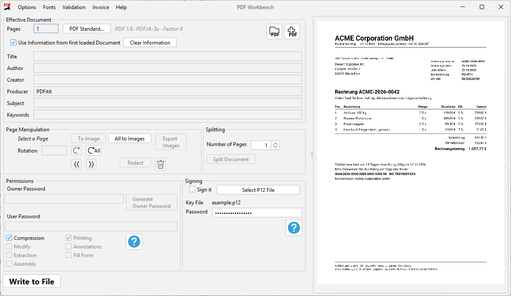

= PDFixit

Apache PDFBox based tool to modify PDFs without paying any money.

ifdef::backend-pdf[(Deutsche Version: link:manual_de.pdf[manual_de.pdf])]
ifndef::backend-pdf[(Deutsche Version: link:README.de.adoc[README.de.adoc])]

This project began when I needed to protect a scanned PDF for an email, but the HP Scanner software couldn’t handle it. My old Brother scanner had this feature - plus other useful tools - and (by the way) worked without requiring any registration. +
Rather than paying for Adobe or other commercial solutions, I turned to the PDFBox documentation.  +
I had used PDFBox in previous commercial projects, though I’d never dealt with PDF protection before.

Thirty minutes later, the first version was up and running, and I sent the email. +
The following days were spent adding fancy features to the UI and the build system - just for fun.

<<<

== Features

=== Load a PDF
Easily import PDF documents for editing

=== Merge Multiple PDFs
Add additional PDFs and either mix pages or append them sequentially.

=== Set Owner and User Passwords
You can simply set a user password to restrict who can view the document. +
Or you can set an owner password and control specific permissions. +
Or you can do both.

=== Enable/Disable Compression
Toggle compression to optimize file size.

=== Set Permissions
Permissions only take effect when an owner password is set. +
The UI automatically disables permission checkboxes unless the password is provided.

=== Remove &amp; Rearrange Pages
Delete pages or change their order.

=== Rotate Pages
Rotate pages by 90°, 180° or 270°.

=== Preview PDF
For you convenience the document is shown using PDFBox’s rendering engine (rending runs in background).

=== Export Embedded Images

Display and export embedded images. +
Some PDF tools seems to split images into fragments - this tool can provide a merged version for you.

=== Convert Page to a single Image

This effectively removes any hidden objects if you e.g. tried to redact documents but hidden text- or image-objects are still in the document. +

<<<

=== Redact Text and Areas

Permanently removes text or rectangular areas. +
In the UI, open the redaction dialog of a page, mark areas with the mouse or search for text. The help button of the dialog explains the details.

How it works: affected pages are rendered to an image, the areas are painted (black by default) and the page is replaced by that image. So the redacted content (and any other text on that page) is really gone and not just covered. Pages without redacted areas are not changed.

On redacted pages, text can't be selected or searched anymore, and annotations (links, comments, form fields) are dropped.

[IMPORTANT%unbreakable]
====
Redaction only cleans the *content of the pages*. The following is *not* removed, check it yourself before you share a redacted document:

* Bookmarks (outline), document information (title, author, ...) and XMP metadata.
* Attached files. An e-invoice is detected: the program asks what to do.
* Values of form fields, they are stored outside the pages.

Text search only finds real text, not text inside images (e.g. scanned pages). Mark such areas by hand.
====

<<<

=== E-Invoices (ZUGFeRD / Factur-X)
Reads, creates and edits e-invoices: a PDF that carries the invoice data as an attached XML file. For invoices that consist of an XML file only (XRechnung), please use an XML tool.

* The menu *Invoice* shows the invoice data, checks the document, saves the attached XML, attaches an XML file or removes the invoice.
* *Invoice > Create Invoice…* (or *Edit Invoice…* if the document already has one) opens an editor for number, dates, seller, buyer, payment and items. The totals are calculated while you type. Missing data is listed before the invoice is attached. Data of an existing invoice that has no field in the form is kept; the tab *All fields* shows and changes it.
* Seller and buyer can be chosen from presets, managed with *Manage…* in the editor or with *Invoice > Invoice Parties…*. A buyer can have default payment terms and days until due.
* An e-invoice needs the PDF standard PDF/A-3. Attaching an invoice converts the document, if necessary. Not every document can be converted; then the invoice is not attached and the document stays unchanged. Details: <<pdf-standards,PDF Standards>>.
* Merging keeps the invoice (if both documents have one, the one of the first document). Splitting keeps it in the first part only.
* Redaction doesn't touch the invoice data, so confidential data may remain in it. The program asks what to do.
* A document with an invoice must not be encrypted, otherwise it is no valid e-invoice any more.

<<<

[[pdf-standards]]
=== PDF Standards
Many offices and authorities require PDFs that stay readable for many years (archiving), or that are suitable for printing or for people with disabilities. Such requirements are met by _PDF standards_, see the table in the <<appendix-pdf-standards,Appendix: PDF Standards>>. A PDF tells which standard it follows, the program shows it beside the page count.

* *Changing the standard:* The button *PDF Standard...* opens a dialog with the available standards. For each one it shows in plain words what will be changed and, marked with a warning icon, what will be lost or can't be fixed. Nothing is changed before you confirm.
* *Not every document can be converted.* The program repairs what can be repaired automatically, but some documents can't be brought to a standard. The check result tells what is missing.
* *Keeping the standard:* A document that follows a standard is protected from changes that would break it. Functions like passwords, splitting or adding documents that don't follow the standard are disabled then. If a loaded document has problems that a repair can fix, the program asks before it changes anything.
* *Invoices:* Attaching an invoice needs PDF/A-3. If the document has another standard, the program asks whether it may switch it.
* *Compression:* PDF/A-1 forbids compression. The program switches the option *Compression* off then and tells you.
* *Removing the standard:* The document is an ordinary PDF afterwards. An e-invoice is no valid e-invoice any more.
* The document information (title, author, ...) is kept in two places in the file, as the archiving standards require both to be equal. The program writes both.

=== Fonts
The menu *Fonts* lists the fonts of the document.

* *Replace:* A selected font can be replaced by one of the bundled fonts, the best match is proposed. The text keeps its characters, but uses the new font.
* *Missing fonts:* Fonts that are not embedded in the document are embedded when a PDF standard requires it. A similar bundled font is used (e.g. Arimo for Arial). Fonts without a metric compatible substitute (e.g. Calibri) look slightly different afterwards. Symbol fonts (Symbol, Wingdings, ...), unusual fonts and characters the substitute doesn't have (e.g. Chinese) can't be replaced; the program reports them and leaves the document unchanged.
* *Own fonts:* *Fonts > Manage Fonts...* imports TrueType font files (`.ttf`), which can then be used like the bundled ones. Fonts with PostScript outlines (OpenType/CFF), font collections (`.ttc`) and fonts that forbid embedding can't be used. A font that lacks characters of the text is refused with a list of the missing characters.
* *Merge Duplicates:* Fonts that exist more than once in the document, e.g. one copy per page, are merged to make the file smaller. Fonts that differ in a way that would change the text are not merged.
* The bundled fonts Arimo, Tinos and Cousine are licensed under the Apache License 2.0.

=== Remember Passwords

[%unbreakable]
--
The option *Remember Passwords* stores the owner, user and signature passwords in the user preferences. +
*Note:* The passwords are stored *unencrypted* (on Windows in the registry, on Linux/macOS in a file in your home directory). Every program running under your account can read them. Don't use this option on shared computers.
--

[%unbreakable]
=== Load Protected PDFs

Allows you to remove or change existing passwords. +
If the current entered owner password does not match the original password of the loaded PDF, the UI will prompt you to
enter the correct one. +
This password input is masked and will not be shown in the UI afterward.

=== Write to File

Saves your modified PDF.

=== Split into Multiple Documents

Export the PDF into separate documents.

=== Language of the User Interface

The menu _Options > Language_ sets the language of the user interface: the system default or one of the bundled languages (currently English and German). +
After a change the program asks whether to restart right away. A restart carries a loaded document, including its unwritten changes, over to the new window.

=== Switch "Look-And-Feels"

Toggle between FlatLaf Dark/Light themes or system defaults. +
The setting is stored in user-preferences.

=== Sign the File with a Certificate

Sign the file using a certificate. +
A `.p12` file with an X.509 certificate is required.

== TODOs

E-mail me if I missed important features. 

== Supported Operating Systems

Distributions are currently only created for *MS Windows*.

The OS-dependent components are only the starter executable and the bundled JRE, designed to make it eeeeasy for Windows users.

The included JAR files in the `lib` folder should run on *any operating system with Java installed*.

For example, on *Linux* or *macOS*, you can run the application using the following command:

[source%unbreakable,console]
----
java -cp "$(printf %s: lib/*.jar)" com.bw.pdfixit.Main
----

This command simply adds all JARs in the lib folder to the classpath.
The main class is `com.bw.pdfixit.Main`.
Calling it without any arguments will launch the *Graphical User Interface (GUI)*. +
Calling it with only file names (no options) opens these files in the GUI, e.g. `PDFixit.exe a.pdf b.pdf` loads `a.pdf` and appends `b.pdf`.

[[cli]]
== Command Line Interface (CLI)

In case you need to call the tool from a *CI/CD Pipeline* or script,
you can use the CLI. +
I assume you have a basic understanding of command-line operations.

*Prerequisites:*

* The current directory of your shell (e.g. Bash) is in the distribution root directory.
* You have a *Java Runtime Environment (JRE)* installed - _see below for *headless* environments_.

To show the usage information of the CLI, use:

[source%unbreakable,console]
----
java -cp "$(printf %s: lib/*.jar)" com.bw.pdfixit.Main -h
----

Add `--debug` to see debug output and stack traces. It also works together with file names to start the UI in debug mode (for the UI or the exe you can also set the system property `pdfixit.debug=true`).

<<<

== Command Line Options

The options of the command line, by task. How to start the tool from the command line is explained in <<cli,Command Line Interface (CLI)>>. Options with a value are written like `--option <value>`; file names with spaces must be put in quotation marks.

[cols="2,3,4"]
|===
|Task |Option |Meaning

|Redact
|`--redactText <regex>`
|Removes text that matches the regular expression. Can be repeated.

|Redact
|`--redactArea <page>:<x>,<y>,<width>,<height>`
|Removes a rectangular area. The values are in points (1/72 inch) from the upper left corner of the page, e.g. `--redactArea 1:50,100,200,20`. Can be repeated.

|E-invoice
|`--extractInvoice <xml file>`
|Saves the invoice XML of the document to a file.

|E-invoice
|`--attachInvoice <xml file>`
|Attaches the invoice XML to the document.

|E-invoice
|`--removeInvoice`
|Removes the invoice. Needed to redact a document that contains an invoice, as the invoice data would not be redacted.

|E-invoice
|`--validateInvoice`
|Checks that the resulting file is a valid e-invoice.

|PDF standard
|`--validatePdfa`
|Checks that the resulting file follows its PDF/A standard.

|Language
|`-Dpdfixit.lang=en`
|Sets the language (`en`, `de`) for one call. It is a Java system property and is written before the program name.
|===

=== Exit Codes

[%unbreakable,cols="1,6"]
|===
|Code |Meaning

|0  |Success.
|1  |Unexpected error, see the error output (use `--debug` for the stack trace).
|2  |No input files given, or invalid command line arguments.
|3  |No output file (`--out`) given.
|4  |Malformed `--merge` argument (not `<start>-<amount>-<skip>`).
|5  |Illegal number in the `--merge` argument.
|6  |Malformed `--redactText` or `--redactArea` argument.
|7  |`--validateInvoice` or `--validatePdfa` combined with `--split`.
|8  |`--extractInvoice` given, but the document contains no invoice.
|9  |Redaction requested for a document with an invoice, but no `--removeInvoice` given.
|10 |The invoice XML (`--attachInvoice`) or the certificate (`--certificate`) doesn't exist.
|11 |The validation of the result failed to run.
|12 |The result is no valid invoice (`--validateInvoice`).
|13 |The attached invoice would not be a conform PDF/A-3 / EN 16931 document. The document is not changed.
|14 |An input file can't be loaded (e.g. wrong or missing password, broken file) or merged. No output is written.
|15 |The result is not PDF/A conform (`--validatePdfa`).
|===

*Note:* The CLI currently supports only a subset of the tool's total functionality. +
Feel free to ask in case you need special functionality.

<<<

=== Headless Environment Considerations

Because the tool uses *PDFBox* for all the magic, there are special considerations for headless environments:

* *GUI is not created for CLI:* +
If the CLI is used, the User Interface is not created, so it should run on a headless system (a server without a display).
* *AWT Dependency:* +
PDFBox internally uses some *Abstract Window Toolkit (AWT)* classes. These classes may require a *full JRE* to work, even if the application is running "off-screen" without a physical display installed. +
*Pure Headless JRE Risk:* A _pure_ headless JRE might throw an error when an AWT class is instantiated. While you might use the CLI on a headless system, using a JRE specifically configured as _purely_ headless may be problematic.

*Recommendation:* Try running it. Success depends on the specific headless JRE implementation you are using.

[[appendix-pdf-standards]]
== Appendix: PDF Standards

A PDF standard is an agreement about what a PDF may contain, so that it behaves the same everywhere and for a long time. The program can set and, as far as that is simple, repair the following ones:

[cols="1,2,4"]
|===
|Standard |Purpose |Specialities

|PDF/A-1b
|Archiving (oldest)
|Looks the same everywhere. No transparency, no attachments (an e-invoice is lost), no compression of the file structure. Can be checked.

|PDF/A-1a
|Archiving
|Like 1b, plus a structure for screen readers. The program can't create that structure; the check tells what is missing.

|PDF/A-2b
|Archiving
|Like 1b, but allows transparency and smaller files. No attachments, except PDF/A files (an e-invoice is lost).

|PDF/A-2u
|Archiving
|Like 2b, plus reliable copying of the text. The program can't create the needed tables for all fonts; the check tells.

|PDF/A-2a
|Archiving
|Like 2u, plus a structure for screen readers (can't be created by the program).

|PDF/A-3b
|Archiving, e-invoices
|Like 2b, but any file may be attached. Used for e-invoices (ZUGFeRD / Factur-X).

|PDF/A-3u, PDF/A-3a
|Archiving, e-invoices
|Like 3b, plus reliable text copying (u), or plus a structure for screen readers (a).

|PDF/A-4
|Archiving (newest)
|Based on a newer PDF version. Simplified levels.

|PDF/A-4e
|Archiving
|Like 4, also for 3D and engineering content.

|PDF/A-4f
|Archiving
|Like 4, attachments are allowed.

|PDF/X-1a, X-3, X-4
|Exchange of print data
|Colors and page boxes must be defined. The program sets information, trim box, sRGB output intent and fonts. X-4 allows transparency. Can't be checked.

|PDF/UA-1
|Accessibility
|Readable by screen readers. The program sets language, title display and tab order, but can't create the structure. Can't be checked.

|PDF/E-1
|Engineering documents
|Exchange of technical documents. Only declared. Can't be checked.

|PDF/VT-1
|Variable data printing
|E.g. mass mailings. Only declared. Can't be checked.
|===

If you are unsure, use *PDF/A-3b* for e-invoices and *PDF/A-2b* for plain archiving.

== Appendix: Dependencies

The libraries and fonts the tool uses (versions are defined in `build.gradle`). The code needs Java 17 or newer.

[cols="2,3,5",options="header"]
|===
|Library |Used for |Task

|https://pdfbox.apache.org[Apache PDFBox] (`pdfbox`, `fontbox`)
|PDF handling
|Reads and writes PDF files and renders the pages for the thumbnails and the page images. It also provides the document structure for merging, splitting, rotating, deleting, redacting, encrypting and signing, and the fonts for the text extraction.

|https://commons.apache.org/proper/commons-logging/[Commons Logging]
|Logging of PDFBox
|PDFBox writes its messages through it. The version is fixed to the one PDFBox uses.

|https://www.bouncycastle.org/java.html[Bouncy Castle] (`bcprov`, `bcpkix`)
|Digital signatures
|Creates the PKCS#7 signature and handles the certificates when a file is signed with `--certificate`.

|https://www.mustangproject.org[Mustang] (`library`, `validator`)
|E-invoices (ZUGFeRD / Factur-X)
|Attaches the invoice XML to a PDF/A-3 document, adds the e-invoice metadata and validates PDF/A-3 and the EN 16931 rules.

|https://github.com/qos-ch/slf4j[SLF4J] (`slf4j-nop`)
|Logging of Mustang
|Discards the log output of Mustang, which would otherwise disturb the console.

|https://verapdf.org[veraPDF] (`core`, `validation-model`, `metadata-fixer`, `feature-reporting`)
|PDF/A validation
|Checks a document against the PDF/A level it declares and repairs its XMP metadata. veraPDF is dual-licensed (GPL 3 or MPL 2.0), this tool uses it under the https://www.mozilla.org/MPL/2.0/[Mozilla Public License 2.0]. It is not modified, the source is at https://github.com/veraPDF/veraPDF-library. The licenses of all libraries are listed in `THIRD-PARTY-LICENSES.txt` beside the jar.

|https://github.com/FasterXML/jackson[Jackson] (`jackson-databind`)
|JSON
|Stores the seller and buyer presets in `~/.pdfixit/parties.json`. The version is the one Mustang uses.

|https://www.formdev.com/flatlaf/[FlatLaf] (`flatlaf`, `flatlaf-fonts-roboto`)
|User interface
|The modern Look-And-Feel, including the light and dark themes, and the Roboto font.

|https://github.com/bweng20/jSVGIcon[jSVGIcon]
|Icons
|Converts the SVG files of the icons (e.g. `calendar.svg`) to Swing icons that scale with the font size.

|https://picocli.info[picocli]
|Command line interface
|Parses the command line options, creates the help text and the exit codes. The annotation processor `picocli-codegen` checks the option annotations while compiling.

|https://fonts.google.com/specimen/Arimo[Arimo, Tinos, Cousine] (bundled `.ttf` files)
|Substitute fonts
|Metric compatible replacements for Arial/Helvetica, Times and Courier. They are embedded when fonts are missing for PDF/A-3 and offered in the _Fonts_ menu. Licensed under the Apache License 2.0.

|https://junit.org/junit5/[JUnit 5]
|Tests
|Runs the unit tests (test scope only, not part of the application).
|===
