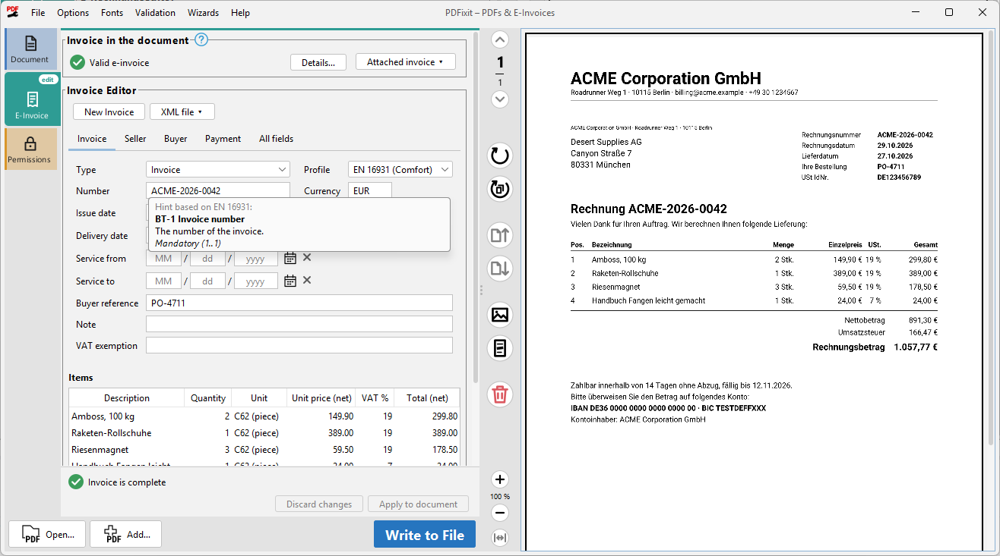

= PDFixit – PDFs & E-Invoices
ifndef::backend-pdf[]
:toc: macro
:toclevels: 2
:toc-title: Contents
endif::[]

Apache PDFBox based tool to modify PDFs without paying any money.

ifdef::backend-pdf[(Deutsche Version: link:manual_de.pdf[manual_de.pdf])]
ifndef::backend-pdf[(Deutsche Version: link:README.de.adoc[README.de.adoc])]

This project began when I needed to protect a scanned PDF for an email, but the HP Scanner software couldn’t handle it. My old Brother scanner had this feature - plus other useful tools - and (by the way) worked without requiring any registration. +
Rather than paying for Adobe or other commercial solutions, I turned to the PDFBox documentation.  +
I had used PDFBox in previous commercial projects, though I’d never dealt with PDF protection before.

Thirty minutes later, the first version was up and running, and I sent the email. +
The following days were spent adding fancy features to the UI and the build system - just for fun.

ifndef::backend-pdf[]
toc::[]
endif::[]

ifdef::backend-pdf[<<<]

== Features

=== Load a PDF
Easily import PDF documents for editing. +
Use _File > Open…_ (Ctrl+O), the button at the bottom left, or drag a file onto the window: the first file is opened, further files are added to the document. _File > Add…_ (Ctrl+Shift+O) adds a document; _File > Write to File_ (Ctrl+S) saves.

[%unbreakable]
=== Load Protected PDFs

Allows you to remove or change existing passwords. +
PDFs that only restrict the permissions open without a password. +
PDFs that need a password to open are first tried with the entered owner password. If it doesn't match, the UI will
prompt you for the password: the password to open the file or the owner password. +
This password input is masked and will not be shown in the UI afterward.

=== Write to File

Saves your modified PDF.

=== Merge Multiple PDFs
Add additional PDFs and either mix pages or append them sequentially.

=== Set Owner and User Passwords
You can simply set a user password to restrict who can view the document. +
Or you can set an owner password and control specific permissions. +
Or you can do both.

=== Enable/Disable Compression
Toggle compression to optimize file size.

=== Set Permissions
Permissions only take effect when an owner password is set. +
The UI automatically disables permission checkboxes unless the password is provided.

=== Remove &amp; Rearrange Pages
Delete pages or change their order.

=== Rotate Pages
Rotate pages by 90°, 180° or 270°.

=== Preview PDF
For you convenience the document is shown using PDFBox’s rendering engine (rending runs in background).
The pages can be zoomed with the small buttons at the bottom of the strip beside them: *+* and *−* (or Ctrl and the mouse wheel) zoom in steps from 50 % to 400 %, around the mouse with the wheel. The button with the arrow between two bars fits the pages to the width of the window again. The pages are moved by dragging with the right mouse button or with Space held, or with the arrow keys (Shift: further). The pages are not rendered again for a zoom, their resolution is the one from the settings.

=== Export Embedded Images

Display and export embedded images. +
Some PDF tools seems to split images into fragments - this tool can provide a merged version for you.

=== Convert Page to a single Image

This effectively removes any hidden objects if you e.g. tried to redact documents but hidden text- or image-objects are still in the document. +

ifdef::backend-pdf[<<<]

=== Redact Text and Areas

Permanently removes text or rectangular areas. +
In the UI, open the redaction dialog of a page, mark areas with the mouse or search for text. The page can be zoomed (buttons, or Ctrl and the mouse wheel) to mark small text precisely, and moved (arrow keys, or dragging with the right mouse button or with Space held), and *Undo* (Ctrl+Z) takes back the last change of the marked areas. The help button of the dialog explains the details.

How it works: affected pages are rendered to an image, the areas are painted (black by default) and the page is replaced by that image. So the redacted content (and any other text on that page) is really gone and not just covered. Pages without redacted areas are not changed.

On redacted pages, text can't be selected or searched anymore, and annotations (links, comments, form fields) are dropped.

[IMPORTANT%unbreakable]
====
Redaction only cleans the *content of the pages*. The following is *not* removed, check it yourself before you share a redacted document:

* Bookmarks (outline), document information (title, author, ...) and XMP metadata.
* Attached files. An e-invoice is detected: the program asks what to do.
* Values of form fields, they are stored outside the pages.

Text search only finds real text, not text inside images (e.g. scanned pages). Mark such areas by hand.
====

ifdef::backend-pdf[<<<]

[[wizards]]
=== Wizards
A wizard leads through a task from its goal. Wizards are started from the menu *Wizards*, or from the cards of the start page, which is shown while no document is open. The menu also holds *Edit Template Layout...* and the submenu *Recent templates* (the last five templates whose layout was edited or used).

*E-Invoice wizard:* creates an e-invoice on your letterhead, or attaches one to an existing PDF. Every step shows what is missing; *Next* is available when nothing is missing, and the help button of the dialog explains the steps.

. *Goal:* a new invoice on a letterhead template, an invoice added to an existing PDF (its pages stay as they are), or a start from an invoice XML file. Document type and profile are chosen here, see <<profiles,Profiles and Versions>>.
. *Seller*, *Buyer*, *Items* and *Payment:* the invoice data, with the same fields and presets as the Invoice tab. The seller is remembered for the next invoice.
. *Template:* the letterhead (see below), a dropdown with the last five templates, a preview with the regions of the layout, a check of the template, and *Edit layout...*.
. *Review:* the invoice is generated and checked (EN 16931 and PDF/A-3) while you look at the pages. Problems are listed with a link to the step, or to the layout editor, that fixes them. The *PDF/A level* and the *language of the invoice* are chosen here and remembered. *Finish* opens the invoice as the current document; it is not saved before you use *Write to File*.

*Templates and layouts:* The template is a plain letterhead PDF from any program (Word, LibreOffice, a print shop, even a scan), without placeholders or marks. The program never changes it: the invoice is written on top of the pages. Where the text goes is stored in a *layout file*, a small `.json` file with the name of the template beside the PDF (`letter.pdf` has `letter.json`). If the folder of the PDF is not writable, or a `.json` file of that name belongs to something else, the layout is stored in the folder `.pdfixit/layouts` of your user folder instead. Without any layout file the positions of DIN 5008 (form B) are used. The layout holds:

* the regions of the fields (number, dates, seller, buyer, return address, page number, ...) and the *body*, where the items, the totals, the payment terms and the bank details flow from page to page;
* the *labels*, which the program prints in front of the values (in German or English, as chosen for the invoice). Each label can be moved or deleted, because a letterhead may print them already;
* a *closing text* and a *signature picture*, which move with the body. The picture is stored inside the layout file, so everyone who gets the file can see it;
* the source of the *following pages*: page 2 of the template (used automatically if the template has two pages), page 1 again, the first page of another PDF, or an empty page. If a long invoice needs a second page and the template has only one, the wizard asks and remembers the answer in the layout.

A value that does not fit its region is an error and is never cut off: enlarge the region in the layout editor.

*Layout editor:* *Wizards > Edit Template Layout...* (or *Edit layout...* in the template step) shows the pages of the template with the regions drawn on them. Regions are moved and resized with the mouse, the list of elements holds the fields of the body in their order, and a panel sets font size, alignment, labels and the following pages. *Sample data* fills the page with a made-up invoice, so you see the effect while you work; warnings tell if a region contains text of the template, leaves the page or is too small. *Reset to DIN 5008* starts again from form A or B. *Save* tells where the layout file was written.

*PDF/A level:* A generated invoice is PDF/A-3. The level is *u* (default: text can be extracted), *b* (basic) or *a* (with a formal structure, see <<tagging,Level a>>). It is chosen in the review step and remembered, and `--pdfaLevel` sets it on the command line. The generated invoice has no logical structure of its own (no support for screen readers); the tags of the template are removed.

ifdef::backend-pdf[<<<]

=== E-Invoices (ZUGFeRD / Factur-X)
Reads, creates and edits e-invoices: a PDF that carries the invoice data as an attached XML file. For invoices that consist of an XML file only (XRechnung), please use an XML tool.

ZUGFeRD is the format for hybrid e-invoices of the Forum elektronische Rechnung Deutschland (FeRD), identical to the French Factur-X. The specification, examples and further information are available at https://www.ferd-net.de[www.ferd-net.de].

* The *Invoice* tab on the left holds everything for the invoice. A label on the tab shows what the editor does: *new* if the document has no invoice yet, *edit* if the editor shows the invoice of the document. The tab has two boxes. *Invoice in the document* shows if the document has an invoice; it is checked automatically (PDF/A-3 and the rules of EN 16931) when the document is loaded or changed, a check never changes the document, *Details…* shows the messages, and *Attached invoice* shows, saves or removes the invoice. *Invoice Editor* creates or edits the invoice.
* The editor contains fields for number, dates, seller, buyer, payment and items. The totals are calculated while you type. Missing data is listed before the invoice is attached. Data of an existing invoice that has no field in the form is kept; the tab *All fields* shows and changes it, with the business term of EN 16931 (e.g. "BT-1 Invoice number"). Below the table a description of the selected value with hints based on the standard is shown: what to enter, if it is mandatory, its format, the allowed codes and the business rules. The fields of the editor show this help as tool tip.
* *Invoice is complete* in the bar at the bottom of the tab (it stays in sight when the editor scrolls) tells if all data is there (or "complete, but 1 hint" if there are notes worth a look); what is missing, or worth a look, is listed above it, beside the sums. Changes in the editor are a draft until you apply them: the mark *modified* in the corner of the editor shows that it differs from the invoice in the document. *Apply to document* (or *Add to document*, *Replace invoice*) in that bar checks the invoice and puts it into the document; an existing invoice is replaced, not duplicated, and an invalid invoice is not applied. *Discard changes* throws the changes away. *Write to File* applies a pending draft, too. Only the invoice data changes, not the visible page of the document. The document is changed in memory, *Write to File* stores it.
* Seller and buyer can be chosen from presets, managed with *Manage…* on the *Seller* and *Buyer* tabs of the editor. A buyer can have default payment terms and days until due.
* *New Invoice* starts a new invoice. *XML file* imports an XML file into the editor or exports the editor as XML file, the document is not changed. *Document* shows the invoice of the document, saves the attached XML as it is or removes the invoice.
* An e-invoice needs the PDF standard PDF/A-3. Attaching an invoice converts the document, if necessary, and keeps the conformance letter of the document: a PDF/A-3a stays a, PDF/A-3u stays u, everything else becomes PDF/A-3b. This applies to the Invoice tab and to `--attachInvoice`. To create the visible invoice, too, use the <<wizards,E-Invoice wizard>>. Not every document can be converted; then the invoice is not attached and the document stays unchanged. Details: <<pdf-standards,PDF Standards>>.
* Merging keeps the invoice (if both documents have one, the one of the first document). Splitting keeps it in the first part only.
* Redaction doesn't touch the invoice data, so confidential data may remain in it. The program asks what to do.
* A document with an invoice must not be encrypted, otherwise it is no valid e-invoice any more.

[[profiles]]
==== Profiles and Versions

The profile (BT-24) decides which data an invoice carries. The editor offers all of them and changes its fields to the profile: fields that a profile doesn't have are disabled, and profiles without items (Minimum, Basic WL) use a table of amounts instead.

[cols="2,5,1,4",options="header"]
|===
|Profile |Guideline ID |Items |Remark
|Minimum |`urn:factur-x.eu:1p0:minimum` |no |Names, tax registration of the seller and the sums only.
|Basic WL |`urn:factur-x.eu:1p0:basicwl` |no |Minimum plus a VAT breakdown.
|Basic |`urn:cen.eu:en16931:2017#compliant#urn:factur-x.eu:1p0:basic` |yes |Items, but fewer fields than EN 16931.
|EN 16931 (Comfort) |`urn:cen.eu:en16931:2017` |yes |The default for new invoices. The full European model.
|Extended |`urn:cen.eu:en16931:2017#conformant#urn:factur-x.eu:1p0:extended` |yes |More than EN 16931. The additional fields are only available in the tab *All fields*.
|XRechnung |`urn:cen.eu:en16931:2017#compliant#urn:xeinkauf.de:kosit:xrechnung_3.0` |yes |Required for invoices to German public authorities: needs the Leitweg-ID as buyer reference and contact data of seller and buyer.
|===

*Which profile is legal?* The program doesn't decide that, it offers all profiles because it can't know what you need. *Not every profile is valid as e-invoice in every country. Please check which profiles are legal for you.* As far as we know (November 2026, no legal advice): Minimum and Basic WL do not count as e-invoice for B2B in Germany from 2026; the French mandate, which starts on 1 September 2026, asks for invoices that conform to EN 16931; other countries (e.g. Poland, Spain, Italy) require their own XML formats, not a hybrid PDF.

*Versions*

* The invoice is checked with Mustang 2.26.0 (August 2026). It contains the Schematron rules of Factur-X 1.09.2 for all five Factur-X profiles and the rules of XRechnung 3.x. A new version of the specification usually needs a new version of Mustang, see <<dependencies,Appendix: Dependencies>>.
* Invoices with the guideline ID of another version (e.g. `urn:zugferd.de:2p0:basic`) are read. The profile is shown by its name if it is known, otherwise as "Other: <id>".
* Not supported yet: XRechnung 4.0 (a pre-release exists since September 2026, the final version is expected for spring 2027, XRechnung 3.0 stays valid until at least 31 July 2027) and the gross invoice feature that is planned for the next release of ZUGFeRD.

ifdef::backend-pdf[<<<]

[[pdf-standards]]
=== PDF Standards
Many offices and authorities require PDFs that stay readable for many years (archiving), or that are suitable for printing or for people with disabilities. Such requirements are met by _PDF standards_, see the table in the <<appendix-pdf-standards,Appendix: PDF Standards>>. A PDF tells which standard it follows, the program shows it beside the page count.

* *Changing the standard:* The button *PDF Standard...* opens a dialog with the available standards. For each one it shows in plain words what will be changed and, marked with a warning icon, what will be lost or can't be fixed. Nothing is changed before you confirm.
* *Not every document can be converted.* The program repairs what can be repaired automatically, but some documents can't be brought to a standard. The check result tells what is missing.
* *Keeping the standard:* A document that follows a standard is protected from changes that would break it. Functions like passwords, splitting or adding documents that don't follow the standard are disabled then. If a loaded document has problems that a repair can fix, a dialog lists them and what a repair would change; nothing is changed unless you click *Repair*.
* *Repair:* The same repair is used everywhere: in the dialog when a document is loaded, in the result of *Validate PDF/A* and in the result after changing the standard (there only if problems remain; the button disappears when none are left). The dialog can be closed and the repair started later from *Validate PDF/A*. The repair fixes content that the standard forbids, adds the sRGB output intent, embeds missing fonts, makes the document information and the XMP metadata equal, removes an invalid XMP extension schema and runs the metadata fixer of veraPDF. A document that declares level a gets the formal structure of <<tagging,Level a>>. The repair never changes the standard on its own: for a PDF/A-1 or PDF/A-2 document with attachments, which only PDF/A-3 allows, the program asks whether to switch it to PDF/A-3b to keep them.
* [[tagging]]*Level a (tagged):* The level a demands a logical structure, which only the program that created the document can describe correctly. If a document has none, the program adds a *formal* structure: one section per page, named by the template `tag.page` ("Page 1", "Page 2", ... or "Seite 1", ... in the language of the program), with the page content as one paragraph. That satisfies the standard, but a screen reader gets no headings, lists, tables or image descriptions. A document that has a structure is never changed. The structure is also added by the repair of a document that declares level a, or by selecting the same level again in *PDF Standard...*.
* *Invoices:* Attaching an invoice needs PDF/A-3. If the document has another standard, the program asks whether it may switch it. The conformance letter is kept: a becomes PDF/A-3a, u becomes PDF/A-3u, every other standard PDF/A-3b.
* *Compression:* PDF/A-1, PDF/X-1a and PDF/X-3 forbid compression. For these standards the option *Compression* is switched off and can't be selected, the program tells you.
* *Removing the standard:* If you set "**none**" the document is an ordinary PDF afterwards. An e-invoice is no valid e-invoice anymore.

=== Fonts
The menu *Fonts* lists the fonts of the document.

* *Replace:* A selected font can be replaced by one of the bundled fonts, the best match is proposed. The text keeps its characters, but uses the new font.
* *Missing fonts:* Fonts that are not embedded in the document are embedded when a PDF standard requires it. A similar bundled font is used (e.g. Arimo for Arial). Fonts without a metric compatible substitute (e.g. Calibri) look slightly different afterwards. The font Symbol is replaced by Symbol Neu Euro. Other symbol fonts (Wingdings, ZapfDingbats, ...), unusual fonts and characters the substitute doesn't have (e.g. Chinese) can't be replaced; the program reports them and leaves the document unchanged.
* *Own fonts:* *Fonts > Manage Fonts...* imports TrueType font files (`.ttf`), which can then be used like the bundled ones. Fonts with PostScript outlines (OpenType/CFF), font collections (`.ttc`) and fonts that forbid embedding can't be used. A font that lacks characters of the text is refused with a list of the missing characters.
* *Merge Duplicates:* Fonts that exist more than once in the document, e.g. one copy per page, are merged to make the file smaller. Fonts that differ in a way that would change the text are not merged.
* The bundled fonts Arimo, Tinos, Cousine and Symbol Neu Euro are licensed under the Apache License 2.0.

=== Remember Passwords

[%unbreakable]
--
The option *Remember Passwords* stores the owner, user and signature passwords in the user preferences. +
*Note:* The passwords are stored *unencrypted* (on Windows in the registry, on Linux/macOS in a file in your home directory). Every program running under your account can read them. Don't use this option on shared computers.
--

=== Split into Multiple Documents

Export the PDF into separate documents.

=== Sign the File with a Certificate

Sign the file using a certificate. +
A `.p12` file with an X.509 certificate is required.

=== Language of the User Interface

The menu _Options > Language_ sets the language of the user interface: the system default or one of the bundled languages (currently English and German). +
After a change the program asks whether to restart right away. A restart carries a loaded document, including its unwritten changes, over to the new window.

=== Switch "Look-And-Feels"

Toggle between FlatLaf Dark/Light themes or system defaults. +
The setting is stored in user-preferences.

== TODOs

E-mail me if I missed important features. 

== Supported Operating Systems

Distributions are currently only created for *MS Windows*.

The OS-dependent components are only the starter executable and the bundled JRE, designed to make it eeeeasy for Windows users.

The included JAR files in the `lib` folder should run on *any operating system with Java installed*.

For example, on *Linux* or *macOS*, you can run the application using the following command:

[source%unbreakable,console]
----
java -cp "$(printf %s: lib/*.jar)" com.bw.pdfixit.Main
----

This command simply adds all JARs in the lib folder to the classpath.
The main class is `com.bw.pdfixit.Main`.
Calling it without any arguments will launch the *Graphical User Interface (GUI)*. +
Calling it with only file names (no options) opens these files in the GUI, e.g. `PDFixit.exe a.pdf b.pdf` loads `a.pdf` and appends `b.pdf`.

[[cli]]
== Command Line Interface (CLI)

In case you need to call the tool from a *CI/CD Pipeline* or script,
you can use the CLI. +
I assume you have a basic understanding of command-line operations.

*Prerequisites:*

* The current directory of your shell (e.g. Bash) is in the distribution root directory.
* You have a *Java Runtime Environment (JRE)* installed - _see below for *headless* environments_.

To show the usage information of the CLI, use:

[source%unbreakable,console]
----
java -cp "$(printf %s: lib/*.jar)" com.bw.pdfixit.Main -h
----

Add `--debug` to see debug output and stack traces. It also works together with file names to start the UI in debug mode (for the UI or the exe you can also set the system property `pdfixit.debug=true`).

ifdef::backend-pdf[<<<]

== Command Line Options

The options of the command line, by task. How to start the tool from the command line is explained in <<cli,Command Line Interface (CLI)>>. Options with a value are written like `--option <value>`; file names with spaces and passwords with special characters must be put in quotation marks. Every option has a short form, which can be used instead (e.g. `-s` for `--split`).

*Files:* All given PDF files are loaded; the first one is the base and the others are appended to it (see `--merge` for another way). The result is written to the file given by `--out`. Without `--out` and without further options, the files are opened in the window instead.

[cols="2,2,5"]
|===
|Option |Short |Meaning

3+^|*Files and pages*

|`--out <file>`
|`-out`
|The file to write the result to.

|`--merge <start>-<amount>-<skip>`
|`-m`
|Mixes the pages of further files into the first one instead of appending them. `5-2-3` starts before page 5 of the first file, inserts 2 pages of the next file, skips 3 pages, inserts the next 2, and so on until all pages are added.

|`--split <pages per file>`
|`-s`
|Splits the result into several files with the given number of pages. The names are extended by a number.

3+^|*Passwords and permissions*

|`--originalpassword <password>`
|`-pw`
|The password to open the given file, if it is protected.

|`--userpassword <password>`
|`-upw`
|User password of the result: needed to open it.

|`--ownerpassword <password>`
|`-opw`
|Owner password of the result: needed to change the permissions. The permissions below only take effect if it is set.

3+^|*Permissions* (only effective if an owner password is set; nothing is allowed unless it is given; `--no-canPrint` etc. switch it off explicitly)

|`--canPrint`
|`-cpt`
|Allow printing.

|`--canModify`
|`-cmd`
|Allow modifying the document.

|`--canExtractContent`
|`-cec`
|Allow copying text and images.

|`--canExtractForAccessibility`
|`-cea`
|Allow copying content for screen readers.

|`--canFillInForm`
|`-cff`
|Allow filling in forms.

|`--canAssemble`
|`-cas`
|Allow inserting, removing and rotating pages.

|`--canModifyAnnotations`
|`-cma`
|Allow changing annotations (comments, signing).

3+^|*Signing*

|`--certificate <p12 file>`
|`-cert`
|Signs the result with the certificate in the file.

|`--certificatePassword <password>`
|`-cpw`
|The password of the certificate file.

3+^|*Redaction*

|`--redactText <regex>`
|`-rt`
|Removes text that matches the regular expression. Can be repeated.

|`--redactArea <page>:<x>,<y>,<width>,<height>`
|`-ra`
|Removes a rectangular area. The values are in points (1/72 inch) from the upper left corner of the page, e.g. `--redactArea 1:50,100,200,20`. Can be repeated.

3+^|*E-invoice*

|`--extractInvoice <xml file>`
|`-ei`
|Saves the invoice XML of the document to a file.

|`--attachInvoice <xml file>`
|`-ai`
|Attaches the invoice XML to the document.

|`--removeInvoice`
|`-ri`
|Removes the invoice. Needed to redact a document that contains an invoice, as the invoice data would not be redacted.

|`--validateInvoice`
|`-vi`
|Checks that the resulting file is a valid e-invoice.

3+^|*Generate an invoice* (needs no input PDF; can't be combined with other options except `--out` and `--debug`)

|`--generateInvoice <xml file>`
|`-gi`
|Prints the invoice XML (CII, ZUGFeRD / Factur-X / XRechnung) on the letterhead given by `--template`, attaches the XML and writes the result to `--out`. The result is checked (PDF/A-3 and EN 16931) and is only written if it is valid.

|`--template <pdf file>`
|`-tp`
|The letterhead PDF. It is never changed.

|`--layout <json file>`
|`-ly`
|A layout file instead of the one found for the template (beside the PDF, then in `.pdfixit/layouts`). Without any layout file the DIN 5008 positions are used.

|`--continuation <template\|page1\|blank\|pdf file>`
|`-co`
|The source of the following pages of a long invoice, if the layout names none: page 2 of the template, page 1 again, empty pages, or the first page of a PDF. The layout file is not changed. The program never asks: a long invoice on a one-page template without this option is an error (exit code 20).

|`--pdfaLevel <a\|b\|u>`
|`-pl`
|The PDF/A-3 level. Default: the setting of the E-Invoice wizard, `u` if there is none.

|`--language <de\|en>`
|`-lg`
|The language of the printed invoice (labels, dates, amounts). Default: the setting of the E-Invoice wizard, otherwise the language of the program.

3+^|*Checks and other*

|`--validatePdfa`
|`-vp`
|Checks that the resulting file follows the PDF standard (PDF/A) it declares.

|`--extractXmp <xmp file>`
|`-ex`
|Saves the XMP metadata of the document to a file.

|`--debug`
|
|Shows detailed messages for troubleshooting.

|`--help`
|`-h`
|Shows the help text with all options.

|`-Dpdfixit.lang=en`
|
|Sets the language (`en`, `de`) for one call. It is a Java system property and is written before the program name.
|===

*Examples* (after the start command):

* Merge two files and protect them with a password: `--out result.pdf --userpassword secret a.pdf b.pdf`
* Split a file into files of 10 pages: `--out part.pdf --split 10 big.pdf`
* Black out an area on page 1: `--out redacted.pdf --redactArea 1:50,100,200,20 in.pdf`
* Attach an invoice: `--out invoice.pdf --attachInvoice invoice.xml in.pdf`
* Print an invoice on a letterhead: `--out invoice.pdf --generateInvoice invoice.xml --template letterhead.pdf --pdfaLevel u --language en`
* The same, with the following pages taken from page 1 of the letterhead: `--out invoice.pdf --generateInvoice invoice.xml --template letterhead.pdf --continuation page1`

*Not available on the command line:* converting to a PDF standard (only checking), replacing or merging fonts, creating the invoice data (a finished XML file is needed; the editor and the wizard create it), editing the layout (the layout editor), switching compression, rotating or removing pages.

ifdef::backend-pdf[<<<]

=== Exit Codes

[%unbreakable,cols="1,6"]
|===
|Code |Meaning

|0  |Success.
|1  |Unexpected error, see the error output (use `--debug` for the stack trace).
|2  |No input files given, or invalid command line arguments.
|3  |No output file (`--out`) given.
|4  |Malformed `--merge` argument (not `<start>-<amount>-<skip>`).
|5  |Illegal number in the `--merge` argument.
|6  |Malformed `--redactText` or `--redactArea` argument.
|7  |`--validateInvoice` or `--validatePdfa` combined with `--split`.
|8  |`--extractInvoice` given, but the document contains no invoice.
|9  |Redaction requested for a document with an invoice, but no `--removeInvoice` given.
|10 |The invoice XML (`--attachInvoice`, `--generateInvoice`), the template, the layout, a continuation PDF or the certificate (`--certificate`) doesn't exist.
|11 |The validation of the result failed to run.
|12 |The result is no valid invoice (`--validateInvoice`, or the generated invoice).
|13 |The attached invoice would not be a conform PDF/A-3 / EN 16931 document. The document is not changed.
|14 |An input file can't be loaded (e.g. wrong or missing password, broken file) or merged. No output is written.
|15 |The result is not PDF/A conform (`--validatePdfa`).
|16 |`--extractXmp` given, but the document contains no XMP metadata.
|17 |Invalid arguments of `--generateInvoice`: no `--template`, a template option without `--generateInvoice`, an unknown value for `--pdfaLevel`, `--language` or `--continuation`, or a combination with input files or other options.
|18 |The invoice XML of `--generateInvoice` can't be read, or its data is incomplete. No output is written.
|19 |The template, the layout or the engine reported errors (for example a layout of another template, or a value that does not fit its region). They are listed with element and page. No output is written.
|20 |The invoice needs more pages than the one-page template has and no `--continuation` is given.
|===

*Note:* The CLI currently supports only a subset of the tool's total functionality. +
Feel free to ask in case you need special functionality.

ifdef::backend-pdf[<<<]

=== Headless Environment Considerations

Because the tool uses *PDFBox* for all the magic, there are special considerations for headless environments:

* *GUI is not created for CLI:* +
If the CLI is used, the User Interface is not created, so it should run on a headless system (a server without a display).
* *AWT Dependency:* +
PDFBox internally uses some *Abstract Window Toolkit (AWT)* classes. These classes may require a *full JRE* to work, even if the application is running "off-screen" without a physical display installed. +
*Pure Headless JRE Risk:* A _pure_ headless JRE might throw an error when an AWT class is instantiated. While you might use the CLI on a headless system, using a JRE specifically configured as _purely_ headless may be problematic.

*Recommendation:* Try running it. Success depends on the specific headless JRE implementation you are using.

== License

ifdef::backend-pdf[]
This project is in the public domain (The Unlicense), see the file `LICENSE`.
endif::[]
ifndef::backend-pdf[]
This project is in the public domain (The Unlicense), see link:LICENSE[LICENSE].
endif::[]

[[Data]]
=== Data

The business terms of the invoice editor (ids, names, occurrence, data types), their descriptions and the business rules are based on the standard EN 16931-1, German version DIN EN 16931-1:2020-12 (EN 16931-1:2017+A1:2019+AC:2020). The descriptions and rules are reworded as short, simple hints in English and German, they are not the wording of the standard; in case of doubt the text of the standard applies. Which XML element of the CII syntax belongs to which business term is taken from `cii-xr.xsl` of https://github.com/itplr-kosit/xrechnung-visualization[KoSIT xrechnung-visualization] (Apache License 2.0).

NOTE: This application contains an implementation of the semantic data model of EN 16931-1. The reproduction is with the permission of CEN and DIN as copyright owners. CEN and DIN bear no liability from the use of the content and implementation of this application and give no warranties expressed or implied for any purpose of such implementation. In case of doubt, the official text of the standard provided by DIN (https://www.dinmedia.de) applies.

The code lists of the invoice editor (countries, currencies, units, payment means, ...) are those of EN 16931, taken from the listing of the European Commission: "Full listing of the code lists as used in EN16931", version 18.0, effective 2026-11-15 (https://ec.europa.eu/digital-building-blocks/sites/display/DIGITAL/Registry+of+supporting+artefacts+to+implement+EN16931[Registry of supporting artefacts to implement EN16931]). The codes and their names are maintained by ISO (ISO 3166-1 country codes, ISO 4217 currency codes, ISO/IEC 6523 identifier schemes), UN/ECE (UNTDID code lists, Recommendations No. 20 and 21 for units), IANA (MIME types) and the European Commission (EAS, VATEX).

ifdef::backend-pdf[<<<]

[[appendix-pdf-standards]]
== Appendix: PDF Standards

A PDF standard is an agreement about what a PDF may contain, so that it behaves the same everywhere and for a long time. The program can set and, as far as that is simple, repair the following ones:

[cols="1,2,4"]
|===
|Standard |Purpose |Specialities

|PDF/A-1b
|Archiving (oldest)
|Looks the same everywhere. No transparency, no attachments (an e-invoice is lost), no compression of the file structure. Can be checked.

|PDF/A-1a
|Archiving
|Like 1b, plus a structure for screen readers. The program adds only a formal structure, see <<tagging,Level a>>.

|PDF/A-2b
|Archiving
|Like 1b, but allows transparency and smaller files. No attachments, except PDF/A files (an e-invoice is lost).

|PDF/A-2u
|Archiving
|Like 2b, plus reliable copying of the text. The program can't create the needed tables for all fonts; the check tells.

|PDF/A-2a
|Archiving
|Like 2u, plus a structure for screen readers (the program adds only a formal one, see <<tagging,Level a>>).

|PDF/A-3b
|Archiving, e-invoices
|Like 2b, but any file may be attached. Used for e-invoices (ZUGFeRD / Factur-X).

|PDF/A-3u, PDF/A-3a
|Archiving, e-invoices
|Like 3b, plus reliable text copying (u), or plus a structure for screen readers (a, the program adds only a formal one, see <<tagging,Level a>>).

|PDF/A-4
|Archiving (newest)
|Based on a newer PDF version. Simplified levels.

|PDF/A-4e
|Archiving
|Like 4, also for 3D and engineering content.

|PDF/A-4f
|Archiving
|Like 4, attachments are allowed.

|PDF/X-1a, X-3, X-4
|Exchange of print data
|Colors and page boxes must be defined. The program sets information, trim box, sRGB output intent and fonts. X-4 allows transparency. Can't be checked.

|PDF/UA-1
|Accessibility
|Readable by screen readers. The program sets language, title display and tab order, but can't create the structure. Can't be checked.

|PDF/E-1
|Engineering documents
|Exchange of technical documents. Only declared. Can't be checked.

|PDF/VT-1
|Variable data printing
|E.g. mass mailings. Only declared. Can't be checked.
|===

If you are unsure, use *PDF/A-3b* for e-invoices and *PDF/A-2b* for plain archiving.

ifdef::backend-pdf[<<<]

[[dependencies]]
== Appendix: Dependencies

The libraries and fonts the tool uses (versions are defined in `build.gradle`). The code needs Java 17 or newer.

[cols="2,3,5",options="header"]
|===
|Library |Used for |Task

|https://pdfbox.apache.org[Apache PDFBox] (`pdfbox`, `fontbox`)
|PDF handling
|Reads and writes PDF files and renders the pages for the thumbnails and the page images. It also provides the document structure for merging, splitting, rotating, deleting, redacting, encrypting and signing, and the fonts for the text extraction.

|https://commons.apache.org/proper/commons-logging/[Commons Logging]
|Logging of PDFBox
|PDFBox writes its messages through it. The version is fixed to the one PDFBox uses.

|https://www.bouncycastle.org/java.html[Bouncy Castle] (`bcprov`, `bcpkix`)
|Digital signatures
|Creates the PKCS#7 signature and handles the certificates when a file is signed with `--certificate`.

|https://www.mustangproject.org[Mustang] (`library`, `validator`)
|E-invoices (ZUGFeRD / Factur-X)
|Attaches the invoice XML to a PDF/A-3 document, adds the e-invoice metadata and validates PDF/A-3 and the EN 16931 rules. Version 2.26.0 contains the rules of ZUGFeRD 2.5.2 / Factur-X 1.09.2.

|https://github.com/qos-ch/slf4j[SLF4J] (`slf4j-nop`)
|Logging of Mustang
|Discards the log output of Mustang, which would otherwise disturb the console.

|https://verapdf.org[veraPDF] (`core`, `validation-model`, `metadata-fixer`, `feature-reporting`)
|PDF/A validation
|Checks a document against the PDF/A level it declares and repairs its XMP metadata. veraPDF is dual-licensed (GPL 3 or MPL 2.0), this tool uses it under the https://www.mozilla.org/MPL/2.0/[Mozilla Public License 2.0]. It is not modified, the source is at https://github.com/veraPDF/veraPDF-library. The licenses of all libraries are listed in `THIRD-PARTY-LICENSES.txt` beside the jar.

|https://github.com/FasterXML/jackson[Jackson] (`jackson-databind`)
|JSON
|Stores the seller and buyer presets in `~/.pdfixit/parties.json`. The version is the one Mustang uses.

|https://www.formdev.com/flatlaf/[FlatLaf] (`flatlaf`, `flatlaf-fonts-roboto`)
|User interface
|The modern Look-And-Feel, including the light and dark themes, and the Roboto font.

|https://github.com/bweng20/jSVGIcon[jSVGIcon]
|Icons
|Converts the SVG files of the icons (e.g. `calendar.svg`) to Swing icons that scale with the font size.

|https://picocli.info[picocli]
|Command line interface
|Parses the command line options, creates the help text and the exit codes. The annotation processor `picocli-codegen` checks the option annotations while compiling.

|https://fonts.google.com/specimen/Arimo[Arimo], https://fonts.google.com/specimen/Tinos[Tinos], https://fonts.google.com/specimen/Cousine[Cousine]  (bundled `.ttf` files)
|Substitute fonts
|Metric compatible replacements for Arial/Helvetica, Times and Courier. They are embedded when fonts are missing for PDF/A-3 and offered in the _Fonts_ menu. Licensed under the Apache License 2.0.

|link:src/main/resources/fonts/SymbolNeuEuro.ttf[Symbol Neu Euro] (bundled `.ttf` file, based on https://archive.debian.org/debian/pool/main/f/fonts-croscore/fonts-croscore_1.23.0.orig.tar.gz[Symbol Neu of the Chrome OS Core Fonts 1.23.0])
|Substitute font for Symbol
|Metric compatible replacement for the font Symbol (Greek letters, mathematical symbols). It is embedded when Symbol is missing in a document for PDF/A-3. Licensed under the Apache License 2.0. The font was extended by the Euro glyph (code 0xA0), copied from Arimo, and renamed because of that.

|https://junit.org/junit5/[JUnit 5]
|Tests
|Runs the unit tests (test scope only, not part of the application).
|===
