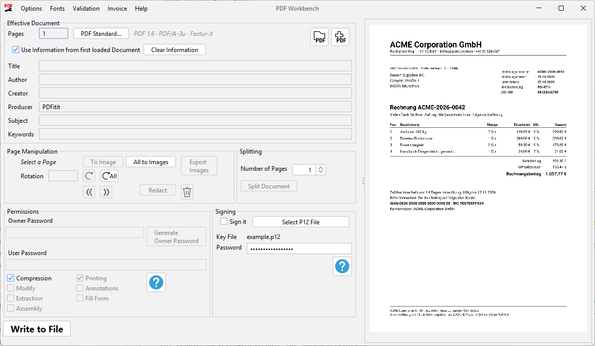

= PDFixit
:lang: de

Auf Apache PDFBox basierendes Werkzeug zum Bearbeiten von PDFs – ohne dafür Geld auszugeben.

ifdef::backend-pdf[(English version: link:manual.pdf[manual.pdf])]
ifndef::backend-pdf[(English version: link:README.adoc[README.adoc])]

Das Projekt entstand, als ich ein gescanntes PDF für eine E-Mail schützen wollte, die HP-Scanner-Software das aber nicht konnte. Mein alter Brother-Scanner hatte diese Funktion – und weitere nützliche Werkzeuge – und funktionierte (nebenbei) ganz ohne Registrierung. +
Statt Adobe oder andere kommerzielle Lösungen zu bezahlen, habe ich mich in die PDFBox-Dokumentation eingelesen. +
PDFBox hatte ich schon in kommerziellen Projekten verwendet, mit PDF-Schutz hatte ich bis dahin aber nichts zu tun.

Dreißig Minuten später lief die erste Version und die E-Mail war verschickt. +
In den folgenden Tagen habe ich – nur zum Spaß – immer weitere Funktionen in die Oberfläche und das Build-System eingebaut.

<<<

== Funktionen

=== PDF laden
PDF-Dokumente einfach zum Bearbeiten importieren.

=== Mehrere PDFs zusammenführen
Weitere PDFs hinzufügen und die Seiten entweder mischen oder hintereinander anhängen.

=== Besitzer- und Benutzerkennwort setzen
Mit einem Benutzerkennwort legen Sie fest, wer das Dokument öffnen darf. +
Mit einem Besitzerkennwort steuern Sie bestimmte Berechtigungen. +
Oder Sie setzen beide.

=== Komprimierung ein-/ausschalten
Die Komprimierung beeinflusst die Dateigröße.

=== Berechtigungen setzen
Berechtigungen wirken nur, wenn ein Besitzerkennwort gesetzt ist. +
Die Oberfläche deaktiviert die Berechtigungs-Kontrollkästchen deshalb, solange kein Kennwort eingegeben ist.

=== Seiten entfernen und umsortieren
Seiten löschen oder ihre Reihenfolge ändern.

=== Seiten drehen
Seiten um 90°, 180° oder 270° drehen.

=== PDF-Vorschau
Das Dokument wird mit der Rendering-Engine von PDFBox angezeigt (das Rendern läuft im Hintergrund).

=== Eingebettete Bilder exportieren

Eingebettete Bilder anzeigen und exportieren. +
Manche PDF-Werkzeuge zerlegen Bilder in Fragmente – dieses Werkzeug kann Ihnen eine zusammengesetzte Version liefern.

=== Seite in ein einziges Bild umwandeln

Dadurch werden versteckte Objekte entfernt, z. B. wenn Sie versucht haben, ein Dokument zu schwärzen, aber versteckte Text- oder Bildobjekte noch im Dokument stecken. +

<<<

=== Text und Bereiche schwärzen

Entfernt Text oder rechteckige Bereiche dauerhaft. +
In der Oberfläche öffnen Sie den Schwärzen-Dialog einer Seite, markieren Bereiche mit der Maus oder suchen nach Text. Die Hilfe-Schaltfläche des Dialogs erklärt die Einzelheiten.

Funktionsweise: Betroffene Seiten werden in ein Bild gerendert, die Bereiche werden übermalt (standardmäßig schwarz) und die Seite wird durch dieses Bild ersetzt. Die geschwärzten Inhalte (und jeder andere Text dieser Seite) sind damit wirklich entfernt und nicht nur verdeckt. Seiten ohne geschwärzte Bereiche bleiben unverändert.

Auf geschwärzten Seiten lässt sich Text nicht mehr markieren oder durchsuchen, und Annotationen (Links, Kommentare, Formularfelder) entfallen.

[IMPORTANT%unbreakable]
====
Das Schwärzen bereinigt nur den *Inhalt der Seiten*. Folgendes wird *nicht* entfernt – prüfen Sie es selbst, bevor Sie ein geschwärztes Dokument weitergeben:

* Lesezeichen (Gliederung), Dokumentinformationen (Titel, Autor, ...) und XMP-Metadaten.
* Angehängte Dateien. Eine E-Rechnung wird erkannt: Das Programm fragt, was geschehen soll.
* Werte von Formularfeldern, da sie außerhalb der Seiten gespeichert sind.

Die Textsuche findet nur echten Text, keinen Text in Bildern (z. B. gescannte Seiten). Solche Bereiche markieren Sie von Hand.
====

<<<

=== E-Rechnungen (ZUGFeRD / Factur-X)
Liest, erstellt und bearbeitet E-Rechnungen: ein PDF, das die Rechnungsdaten als angehängte XML-Datei enthält. Für Rechnungen, die nur aus einer XML-Datei bestehen (XRechnung), nehmen Sie bitte ein XML Tool.

* Das Menü *Rechnung* zeigt die Rechnungsdaten, prüft das Dokument, speichert das angehängte XML, hängt eine XML-Datei an oder entfernt die Rechnung.
* *Rechnung > Rechnung erstellen…* (bzw. *Rechnung bearbeiten…*, wenn das Dokument bereits eine enthält) öffnet einen Editor für Nummer, Datum, Verkäufer, Käufer, Zahlung und Positionen. Die Summen werden beim Tippen berechnet. Fehlende Angaben werden vor dem Anhängen aufgelistet. Daten einer vorhandenen Rechnung, die kein Feld im Formular haben, bleiben erhalten; der Reiter *Alle Felder* zeigt und ändert sie.
* Verkäufer und Käufer können aus Vorlagen gewählt werden, die mit *Verwalten…* im Editor oder mit *Rechnung > Rechnungsparteien…* verwaltet werden. Ein Käufer kann Standard-Zahlungsbedingungen und ein Zahlungsziel haben.
* Eine E-Rechnung benötigt den PDF-Standard PDF/A-3. Beim Anhängen einer Rechnung wird das Dokument bei Bedarf umgewandelt. Nicht jedes Dokument lässt sich umwandeln; dann wird die Rechnung nicht angehängt und das Dokument bleibt unverändert. Details: <<pdf-standards,PDF-Standards>>.
* Beim Zusammenführen bleibt die Rechnung erhalten (haben beide Dokumente eine, die des ersten). Beim Aufteilen bleibt sie nur im ersten Teil.
* Das Schwärzen berührt die Rechnungsdaten nicht, vertrauliche Daten können darin verbleiben. Das Programm fragt nach, was geschehen soll.
* Ein Dokument mit Rechnung darf nicht verschlüsselt sein, sonst ist es keine gültige E-Rechnung mehr.

<<<

[[pdf-standards]]
=== PDF-Standards
Viele Firmen und Behörden verlangen PDFs, die über Jahre lesbar bleiben (Archivierung) oder die sich für den Druck oder für Menschen mit Behinderung eignen. Solche Anforderungen erfüllen _PDF-Standards_, siehe die Tabelle im <<appendix-pdf-standards,Anhang: PDF-Standards>>. Ein PDF gibt an, welchem Standard es folgt; das Programm zeigt ihn neben der Seitenzahl an.

* *Standard ändern:* Die Schaltfläche *PDF-Standard...* öffnet einen Dialog mit den verfügbaren Standards. Zu jedem zeigt er in einfachen Worten, was geändert wird und – mit Warnsymbol – was verloren geht oder sich nicht beheben lässt. Vor der Bestätigung wird nichts verändert.
* *Nicht jedes Dokument lässt sich umwandeln.* Das Programm repariert automatisch, was sich reparieren lässt, manche Dokumente lassen sich aber nicht in einen Standard bringen. Das Prüfergebnis sagt, was fehlt.
* *Standard erhalten:* Ein Dokument, das einem Standard folgt, wird vor Änderungen geschützt, die ihn verletzen würden. Funktionen wie Kennwörter, Aufteilen oder das Anhängen von Dokumenten, die dem Standard nicht folgen, sind dann deaktiviert. Hat ein geladenes Dokument Mängel, die eine Reparatur beheben kann, fragt das Programm, bevor es etwas ändert.
* *Rechnungen:* Das Anhängen einer Rechnung erfordert PDF/A-3. Hat das Dokument einen anderen Standard, fragt das Programm, ob umgestellt werden darf.
* *Komprimierung:* PDF/A-1 verbietet Komprimierung. Das Programm schaltet die Option *Komprimierung* dann aus und teilt das mit.
* *Standard entfernen:* Wenn "**keiner**" gesetzt wird, ist das Dokument danach ein gewöhnliches PDF. Eine E-Rechnung ist dadurch keine gültige E-Rechnung mehr.
* Die Dokumentinformationen (Titel, Autor, ...) stehen an zwei Stellen in der Datei, da die Archivierungsstandards verlangen, dass beide gleich sind. Das Programm schreibt beide.

=== Schriften
Das Menü *Schriften* listet die Schriften des Dokuments.

* *Ersetzen:* Eine gewählte Schrift kann durch eine der mitgelieferten ersetzt werden, die beste Übereinstimmung wird vorgeschlagen. Der Text behält seine Zeichen, verwendet aber die neue Schrift.
* *Fehlende Schriften:* Nicht eingebettete Schriften werden eingebettet, wenn ein PDF-Standard es verlangt. Dafür dient eine ähnliche mitgelieferte Schrift (z. B. Arimo für Arial). Schriften ohne metrisch kompatiblen Ersatz (z. B. Calibri) sehen danach etwas anders aus. Symbolschriften (Symbol, Wingdings, ...), ungewöhnliche Schriften und Zeichen, die der Ersatz nicht hat (z. B. Chinesisch), lassen sich nicht ersetzen; das Programm meldet sie und lässt das Dokument unverändert.
* *Eigene Schriften:* *Schriften > Schriften verwalten...* importiert TrueType-Dateien (`.ttf`), die dann wie die mitgelieferten verwendet werden können. Schriften mit PostScript-Konturen (OpenType/CFF), Schriftsammlungen (`.ttc`) und Schriften, die das Einbetten verbieten, sind nicht verwendbar. Fehlen einer Schrift Zeichen des Textes, wird sie mit einer Liste der fehlenden Zeichen abgelehnt.
* *Duplikate zusammenführen:* Mehrfach vorhandene Schriften, z. B. eine Kopie je Seite, werden zusammengeführt, um die Datei zu verkleinern. Schriften, die sich so unterscheiden, dass der Text sich ändern würde, werden nicht zusammengeführt.
* Die mitgelieferten Schriften Arimo, Tinos und Cousine stehen unter der Apache License 2.0.

=== Kennwörter merken

[%unbreakable]
--
Die Option *Kennwörter merken* speichert Besitzer-, Benutzer- und Signaturkennwort in den Benutzereinstellungen. +
*Hinweis:* Die Kennwörter werden *unverschlüsselt* gespeichert (unter Windows in der Registry, unter Linux/macOS in einer Datei im Home-Verzeichnis). Jedes Programm, das unter Ihrem Konto läuft, kann sie lesen. Verwenden Sie diese Option nicht auf gemeinsam genutzten Rechnern.
--

[%unbreakable]
=== Geschützte PDFs laden

Erlaubt es, vorhandene Kennwörter zu entfernen oder zu ändern. +
Stimmt das eingegebene Besitzerkennwort nicht mit dem ursprünglichen Kennwort des geladenen PDFs überein, fordert die Oberfläche zur Eingabe des richtigen auf. +
Diese Eingabe ist maskiert und wird danach nicht mehr angezeigt.

=== In Datei schreiben

Speichert das geänderte PDF.

=== In mehrere Dokumente aufteilen

Das PDF in einzelne Dokumente exportieren.

=== Sprache der Oberfläche

Das Menü _Optionen > Sprache_ stellt die Sprache der Oberfläche ein: die Systemvorgabe oder eine der mitgelieferten Sprachen (derzeit Englisch und Deutsch). +
Nach einer Änderung fragt das Programm, ob es sofort neu gestartet werden soll. Beim Neustart wird ein geladenes Dokument samt ungeschriebenen Änderungen übernommen.

=== „Look-And-Feel“ wechseln

Zwischen den FlatLaf-Themen Dunkel/Hell oder den Systemvorgaben umschalten. +
Die Einstellung wird in den Benutzereinstellungen gespeichert.

=== Datei mit einem Zertifikat signieren

Die Datei mit einem Zertifikat signieren. +
Erforderlich ist eine `.p12`-Datei mit einem X.509-Zertifikat.

== TODOs

Schreiben Sie mir eine E-Mail, falls ich wichtige Funktionen vergessen habe.

== Unterstützte Betriebssysteme

Distributionen werden derzeit nur für *MS Windows* erstellt.

Betriebssystemabhängig sind nur die Startdatei und die mitgelieferte JRE, die Windows-Benutzern den Einstieg besonders leicht machen sollen.

Die enthaltenen JAR-Dateien im Ordner `lib` laufen auf *jedem Betriebssystem mit installiertem Java*.

Unter *Linux* oder *macOS* starten Sie die Anwendung zum Beispiel so:

[source%unbreakable,console]
----
java -cp "$(printf %s: lib/*.jar)" com.bw.pdfixit.Main
----

Dieser Befehl nimmt einfach alle JARs aus dem Ordner `lib` in den Klassenpfad auf.
Die Hauptklasse ist `com.bw.pdfixit.Main`.
Ohne Argumente startet sie die *grafische Oberfläche (GUI)*. +
Mit reinen Dateinamen (ohne Optionen) werden diese Dateien in der GUI geöffnet, z. B. lädt `PDFixit.exe a.pdf b.pdf` die Datei `a.pdf` und hängt `b.pdf` an.

<<<

[[cli]]
== Kommandozeile (CLI)

Wenn Sie das Werkzeug aus einer *CI/CD-Pipeline* oder einem Skript aufrufen möchten, steht die Kommandozeile zur Verfügung. +
Ich setze Grundkenntnisse im Umgang mit der Kommandozeile voraus.

*Voraussetzungen:*

* Das aktuelle Verzeichnis Ihrer Shell (z. B. Bash) ist das Hauptverzeichnis der Distribution.
* Eine *Java Runtime Environment (JRE)* ist installiert – _für Umgebungen ohne Display siehe unten_.

Die Hilfe der Kommandozeile zeigen Sie so an:

[source%unbreakable,console]
----
java -cp "$(printf %s: lib/*.jar)" com.bw.pdfixit.Main -h
----

Mit `--debug` erscheinen Debug-Ausgaben und Stacktraces. Die Option funktioniert auch zusammen mit Dateinamen, um die Oberfläche im Debug-Modus zu starten (für Oberfläche oder exe können Sie auch die Systemeigenschaft `pdfixit.debug=true` setzen).

<<<

=== Kommandozeilenoptionen

Die Optionen der Kommandozeile, nach Aufgaben geordnet. Wie das Werkzeug von der Kommandozeile gestartet wird, steht unter <<cli,Kommandozeile (CLI)>>. Optionen mit einem Wert werden als `--option <wert>` geschrieben; Dateinamen mit Leerzeichen und Kennwörter mit Sonderzeichen müssen in Anführungszeichen stehen. Jede Option hat eine Kurzform, die stattdessen verwendet werden kann (z. B. `-s` für `--split`).

*Dateien:* Alle angegebenen PDF-Dateien werden geladen; die erste ist die Grundlage, die anderen werden angehängt (siehe `--merge` für eine andere Art). Das Ergebnis wird in die mit `--out` angegebene Datei geschrieben. Ohne `--out` und ohne weitere Optionen werden die Dateien stattdessen im Fenster geöffnet.

[cols="2,2,5"]
|===
|Option |Kurz |Bedeutung

3+^|*Dateien und Seiten*

|`--out <Datei>`
|`-out`
|Die Datei, in die das Ergebnis geschrieben wird.

|`--merge <start>-<anzahl>-<überspringen>`
|`-m`
|Mischt die Seiten weiterer Dateien in die erste, statt sie anzuhängen. `5-2-3` beginnt vor Seite 5 der ersten Datei, fügt 2 Seiten der nächsten Datei ein, überspringt 3 Seiten, fügt die nächsten 2 ein usw., bis alle Seiten eingefügt sind.

|`--split <Seiten pro Datei>`
|`-s`
|Teilt das Ergebnis in mehrere Dateien mit der angegebenen Seitenzahl. Die Namen werden um eine Nummer erweitert.

3+^|*Kennwörter und Berechtigungen*

|`--originalpassword <Kennwort>`
|`-pw`
|Das Kennwort zum Öffnen der angegebenen Datei, falls sie geschützt ist.

|`--userpassword <Kennwort>`
|`-upw`
|Benutzerkennwort des Ergebnisses: nötig, um es zu öffnen.

|`--ownerpassword <Kennwort>`
|`-opw`
|Besitzerkennwort des Ergebnisses: nötig, um die Berechtigungen zu ändern. Die folgenden Berechtigungen wirken nur, wenn es gesetzt ist.

3+^|*Berechtigungen* (nur wirksam, wenn ein Besitzerkennwort gesetzt ist; ohne Angabe ist nichts erlaubt; `--no-canPrint` usw. schalten es ausdrücklich aus)

|`--canPrint`
|`-cpt`
|Drucken erlauben.

|`--canModify`
|`-cmd`
|Ändern des Dokuments erlauben.

|`--canExtractContent`
|`-cec`
|Kopieren von Text und Bildern erlauben.

|`--canExtractForAccessibility`
|`-cea`
|Kopieren von Inhalt für Screenreader erlauben.

|`--canFillInForm`
|`-cff`
|Ausfüllen von Formularen erlauben.

|`--canAssemble`
|`-cas`
|Einfügen, Entfernen und Drehen von Seiten erlauben.

|`--canModifyAnnotations`
|`-cma`
|Ändern von Anmerkungen (Kommentare, Signieren) erlauben.

3+^|*Signieren*

|`--certificate <p12-Datei>`
|`-cert`
|Signiert das Ergebnis mit dem Zertifikat der Datei.

|`--certificatePassword <Kennwort>`
|`-cpw`
|Das Kennwort der Zertifikatsdatei.

3+^|*Schwärzen*

|`--redactText <regex>`
|`-rt`
|Entfernt Text, der zum regulären Ausdruck passt. Kann mehrfach angegeben werden.

|`--redactArea <Seite>:<x>,<y>,<Breite>,<Höhe>`
|`-ra`
|Entfernt einen rechteckigen Bereich. Die Werte sind in Punkt (1/72 Zoll) von der linken oberen Seitenecke angegeben, z. B. `--redactArea 1:50,100,200,20`. Kann mehrfach angegeben werden.

3+^|*E-Rechnung*

|`--extractInvoice <xml-Datei>`
|`-ei`
|Speichert das Rechnungs-XML des Dokuments in einer Datei.

|`--attachInvoice <xml-Datei>`
|`-ai`
|Hängt das Rechnungs-XML an das Dokument an.

|`--removeInvoice`
|`-ri`
|Entfernt die Rechnung. Nötig, um ein Dokument mit Rechnung zu schwärzen, da die Rechnungsdaten nicht geschwärzt würden.

|`--validateInvoice`
|`-vi`
|Prüft, ob die entstehende Datei eine gültige E-Rechnung ist.

3+^|*Prüfungen und Sonstiges*

|`--validatePdfa`
|`-vp`
|Prüft, ob die entstehende Datei dem PDF-Standard (PDF/A) entspricht, den sie angibt.

|`--debug`
|
|Zeigt ausführliche Meldungen zur Fehlersuche.

|`--help`
|`-h`
|Zeigt den Hilfetext mit allen Optionen.

|`-Dpdfixit.lang=en`
|
|Legt die Sprache (`en`, `de`) für einen Aufruf fest. Es ist eine Java-Systemeigenschaft und steht vor dem Programmnamen.
|===

*Beispiele* (hinter dem Startbefehl):

* Zwei Dateien zusammenführen und mit einem Kennwort schützen: `--out ergebnis.pdf --userpassword geheim a.pdf b.pdf`
* Eine Datei in Teile zu 10 Seiten aufteilen: `--out teil.pdf --split 10 gross.pdf`
* Einen Bereich auf Seite 1 schwärzen: `--out geschwaerzt.pdf --redactArea 1:50,100,200,20 in.pdf`
* Eine Rechnung anhängen: `--out rechnung.pdf --attachInvoice rechnung.xml in.pdf`

*Auf der Kommandozeile nicht verfügbar:* Umwandeln in einen PDF-Standard (nur Prüfen), Ersetzen oder Zusammenführen von Schriften, Erzeugen einer Rechnung aus Daten (nur Anhängen einer fertigen XML-Datei), Komprimierung umschalten, Seiten drehen oder entfernen.

=== Exit-Codes

[%unbreakable,cols="1,6"]
|===
|Code |Bedeutung

|0  |Erfolg.
|1  |Unerwarteter Fehler, siehe Fehlerausgabe (Stacktrace mit `--debug`).
|2  |Keine Eingabedateien angegeben oder ungültige Kommandozeilenargumente.
|3  |Keine Ausgabedatei (`--out`) angegeben.
|4  |Fehlerhaftes `--merge`-Argument (nicht `<start>-<anzahl>-<überspringen>`).
|5  |Ungültige Zahl im `--merge`-Argument.
|6  |Fehlerhaftes `--redactText`- oder `--redactArea`-Argument.
|7  |`--validateInvoice` oder `--validatePdfa` zusammen mit `--split`.
|8  |`--extractInvoice` angegeben, das Dokument enthält aber keine Rechnung.
|9  |Schwärzen eines Dokuments mit Rechnung verlangt, aber `--removeInvoice` fehlt.
|10 |Das Rechnungs-XML (`--attachInvoice`) oder das Zertifikat (`--certificate`) existiert nicht.
|11 |Die Validierung des Ergebnisses konnte nicht ausgeführt werden.
|12 |Das Ergebnis ist keine gültige Rechnung (`--validateInvoice`).
|13 |Die angehängte Rechnung wäre kein konformes PDF/A-3- bzw. EN-16931-Dokument. Das Dokument bleibt unverändert.
|14 |Eine Eingabedatei kann nicht geladen (z. B. falsches oder fehlendes Kennwort, defekte Datei) oder nicht zusammengeführt werden. Es wird keine Ausgabe geschrieben.
|15 |Das Ergebnis ist nicht PDF/A-konform (`--validatePdfa`).
|===

*Hinweis:* Die Kommandozeile unterstützt derzeit nur einen Teil des gesamten Funktionsumfangs. +
Fragen Sie gerne nach, wenn Sie eine bestimmte Funktion brauchen.

<<<

=== Umgebungen ohne Display (headless)

Da das Werkzeug für die ganze Arbeit *PDFBox* verwendet, gibt es für Umgebungen ohne Display einige Besonderheiten:

* *Keine GUI für die Kommandozeile:* +
Bei Verwendung der Kommandozeile wird die Oberfläche nicht erzeugt, sie sollte also auf einem System ohne Display (Server) laufen.
* *AWT-Abhängigkeit:* +
PDFBox verwendet intern einige Klassen des *Abstract Window Toolkit (AWT)*. Diese setzen unter Umständen eine *vollständige JRE* voraus, selbst wenn die Anwendung „unsichtbar“ ohne physisches Display läuft. +
*Risiko bei rein headless-fähiger JRE:* Eine _rein_ headless-fähige JRE kann beim Erzeugen einer AWT-Klasse einen Fehler auslösen. Die Kommandozeile lässt sich zwar auf einem System ohne Display verwenden, eine ausdrücklich _rein_ headless konfigurierte JRE kann aber Probleme machen.

*Empfehlung:* Probieren Sie es aus. Der Erfolg hängt von der verwendeten headless-JRE ab.

== Lizenz

ifdef::backend-pdf[]
Dieses Projekt ist gemeinfrei (The Unlicense), siehe die Datei `LICENSE`.
endif::[]
ifndef::backend-pdf[]
Dieses Projekt ist gemeinfrei (The Unlicense), siehe link:LICENSE[LICENSE].
endif::[]

<<<

[[appendix-pdf-standards]]
== Anhang: PDF-Standards

Ein PDF-Standard ist eine Vereinbarung darüber, was ein PDF enthalten darf, damit es überall und lange gleich funktioniert. Das Programm kann die folgenden setzen und, soweit einfach, reparieren:

[cols="1,2,4"]
|===
|Standard |Zweck |Besonderheiten

|PDF/A-1b
|Archivierung (älteste)
|Sieht überall gleich aus. Keine Transparenz, keine Anhänge (eine E-Rechnung geht verloren), keine Komprimierung der Dateistruktur. Prüfbar.

|PDF/A-1a
|Archivierung
|Wie 1b, dazu eine Struktur für Screenreader. Das Programm kann diese Struktur nicht erzeugen; die Prüfung sagt, was fehlt.

|PDF/A-2b
|Archivierung
|Wie 1b, erlaubt aber Transparenz und kleinere Dateien. Keine Anhänge außer PDF/A-Dateien (eine E-Rechnung geht verloren).

|PDF/A-2u
|Archivierung
|Wie 2b, dazu zuverlässiges Kopieren des Textes. Das Programm kann die nötigen Tabellen nicht für alle Schriften erzeugen; die Prüfung sagt es.

|PDF/A-2a
|Archivierung
|Wie 2u, dazu eine Struktur für Screenreader (vom Programm nicht erzeugbar).

|PDF/A-3b
|Archivierung, E-Rechnungen
|Wie 2b, aber beliebige Dateien dürfen angehängt sein. Wird für E-Rechnungen (ZUGFeRD / Factur-X) verwendet.

|PDF/A-3u, PDF/A-3a
|Archivierung, E-Rechnungen
|Wie 3b, dazu zuverlässiges Kopieren des Textes (u) bzw. eine Struktur für Screenreader (a).

|PDF/A-4
|Archivierung (neueste)
|Beruht auf einer neueren PDF-Version. Vereinfachte Stufen.

|PDF/A-4e
|Archivierung
|Wie 4, auch für 3D- und technische Inhalte.

|PDF/A-4f
|Archivierung
|Wie 4, Anhänge sind erlaubt.

|PDF/X-1a, X-3, X-4
|Austausch von Druckdaten
|Farben und Seitenrahmen müssen festgelegt sein. Das Programm setzt Informationen, Trim-Box, sRGB-Ausgabeintent und Schriften. X-4 erlaubt Transparenz. Nicht prüfbar.

|PDF/UA-1
|Barrierefreiheit
|Von Screenreadern lesbar. Das Programm setzt Sprache, Titelanzeige und Tab-Reihenfolge, kann aber die Struktur nicht erzeugen. Nicht prüfbar.

|PDF/E-1
|Technische Dokumente
|Austausch technischer Dokumente. Nur deklariert. Nicht prüfbar.

|PDF/VT-1
|Druck mit variablen Daten
|Z. B. Serienbriefe. Nur deklariert. Nicht prüfbar.
|===

Im Zweifel: *PDF/A-3b* für E-Rechnungen und *PDF/A-2b* für reine Archivierung.

<<<

== Anhang: Abhängigkeiten

Die vom Werkzeug verwendeten Bibliotheken und Schriften (die Versionen stehen in `build.gradle`). Der Code benötigt Java 17 oder neuer.

[cols="2,3,5",options="header"]
|===
|Bibliothek |Verwendet für |Aufgabe

|https://pdfbox.apache.org[Apache PDFBox] (`pdfbox`, `fontbox`)
|PDF-Verarbeitung
|Liest und schreibt PDF-Dateien und rendert die Seiten für Vorschaubilder und Seitenbilder. Liefert außerdem die Dokumentstruktur zum Zusammenführen, Aufteilen, Drehen, Löschen, Schwärzen, Verschlüsseln und Signieren sowie die Schriften für die Textextraktion.

|https://commons.apache.org/proper/commons-logging/[Commons Logging]
|Protokollierung von PDFBox
|PDFBox schreibt seine Meldungen darüber. Die Version ist auf die von PDFBox verwendete festgelegt.

|https://www.bouncycastle.org/java.html[Bouncy Castle] (`bcprov`, `bcpkix`)
|Digitale Signaturen
|Erzeugt die PKCS#7-Signatur und verarbeitet die Zertifikate, wenn eine Datei mit `--certificate` signiert wird.

|https://www.mustangproject.org[Mustang] (`library`, `validator`)
|E-Rechnungen (ZUGFeRD / Factur-X)
|Hängt das Rechnungs-XML an ein PDF/A-3-Dokument an, ergänzt die E-Rechnungs-Metadaten und validiert PDF/A-3 und die EN-16931-Regeln.

|https://github.com/qos-ch/slf4j[SLF4J] (`slf4j-nop`)
|Protokollierung von Mustang
|Verwirft die Log-Ausgaben von Mustang, die sonst die Konsole stören würden.

|https://verapdf.org[veraPDF] (`core`, `validation-model`, `metadata-fixer`, `feature-reporting`)
|PDF/A-Validierung
|Prüft ein Dokument gegen die deklarierte PDF/A-Stufe und repariert die XMP-Metadaten. veraPDF steht unter Doppellizenz (GPL 3 oder MPL 2.0), dieses Werkzeug verwendet es unter der https://www.mozilla.org/MPL/2.0/[Mozilla Public License 2.0]. Es wird nicht verändert, der Quellcode liegt unter https://github.com/veraPDF/veraPDF-library. Die Lizenzen aller Bibliotheken stehen in `THIRD-PARTY-LICENSES.txt` neben dem Jar.

|https://github.com/FasterXML/jackson[Jackson] (`jackson-databind`)
|JSON
|Speichert die Verkäufer- und Käufervorlagen in `~/.pdfixit/parties.json`. Die Version ist die von Mustang verwendete.

|https://www.formdev.com/flatlaf/[FlatLaf] (`flatlaf`, `flatlaf-fonts-roboto`)
|Benutzeroberfläche
|Das moderne Look-And-Feel einschließlich heller und dunkler Themen sowie die Schrift Roboto.

|https://github.com/bweng20/jSVGIcon[jSVGIcon]
|Symbole
|Wandelt die SVG-Dateien der Symbole (z. B. `calendar.svg`) in Swing-Icons um, die mit der Schriftgröße skalieren.

|https://picocli.info[picocli]
|Kommandozeile
|Verarbeitet die Kommandozeilenoptionen, erzeugt den Hilfetext und die Exit-Codes. Der Annotation-Processor `picocli-codegen` prüft beim Kompilieren die Optionsannotationen.

|https://fonts.google.com/specimen/Arimo[Arimo, Tinos, Cousine] (mitgelieferte `.ttf`-Dateien)
|Ersatzschriften
|Metrisch kompatible Ersatzschriften für Arial/Helvetica, Times und Courier. Sie werden eingebettet, wenn für PDF/A-3 Schriften fehlen, und im Menü _Schriften_ angeboten. Lizenziert unter der Apache License 2.0.

|https://junit.org/junit5/[JUnit 5]
|Tests
|Führt die Unit-Tests aus (nur Test-Scope, nicht Teil der Anwendung).
|===

