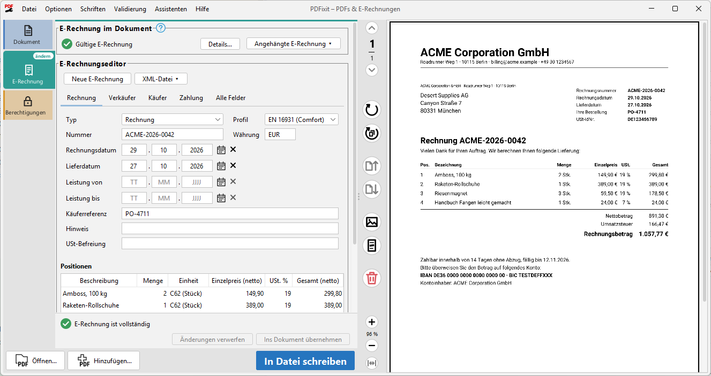

= PDFixit – PDFs & E-Rechnungen
:lang: de
ifndef::backend-pdf[]
:toc: macro
:toclevels: 2
:toc-title: Inhalt
endif::[]

Auf Apache PDFBox basierendes Werkzeug zum Bearbeiten von PDFs – ohne dafür Geld auszugeben.

ifdef::backend-pdf[(English version: link:manual.pdf[manual.pdf])]
ifndef::backend-pdf[(English version: link:README.adoc[README.adoc])]

Das Projekt entstand, als ich ein gescanntes PDF für eine E-Mail schützen wollte, die HP-Scanner-Software das aber nicht konnte. Mein alter Brother-Scanner hatte diese Funktion – und weitere nützliche Werkzeuge – und funktionierte (nebenbei) ganz ohne Registrierung. +
Statt Adobe oder andere kommerzielle Lösungen zu bezahlen, habe ich mich in die PDFBox-Dokumentation eingelesen. +
PDFBox hatte ich schon in kommerziellen Projekten verwendet, mit PDF-Schutz hatte ich bis dahin aber nichts zu tun.

Dreißig Minuten später lief die erste Version und die E-Mail war verschickt. +
In den folgenden Tagen habe ich – nur zum Spaß – immer weitere Funktionen in die Oberfläche und das Build-System eingebaut.

ifndef::backend-pdf[]
toc::[]
endif::[]

ifdef::backend-pdf[<<<]

== Funktionen

=== PDF laden
PDF-Dokumente einfach zum Bearbeiten importieren. +
Über _Datei > Öffnen…_ (Strg+O), die Schaltfläche unten links oder per Drag & Drop auf das Fenster: Die erste Datei wird geöffnet, weitere Dateien werden zum Dokument hinzugefügt. _Datei > Hinzufügen…_ (Strg+Umschalt+O) fügt ein Dokument hinzu; _Datei > In Datei schreiben_ (Strg+S) speichert.

[%unbreakable]
=== Geschützte PDFs laden

Erlaubt es, vorhandene Kennwörter zu entfernen oder zu ändern. +
PDFs, die nur die Berechtigungen einschränken, öffnen sich ohne Kennwort. +
PDFs, die zum Öffnen ein Kennwort brauchen, werden zuerst mit dem eingegebenen Besitzerkennwort versucht. Passt es nicht, fragt die Oberfläche nach dem Kennwort: dem Kennwort zum Öffnen oder dem Besitzerkennwort. +
Diese Eingabe ist maskiert und wird danach nicht mehr angezeigt.

=== In Datei schreiben

Speichert das geänderte PDF.

=== Mehrere PDFs zusammenführen
Weitere PDFs hinzufügen und die Seiten entweder mischen oder hintereinander anhängen.

=== Besitzer- und Benutzerkennwort setzen
Mit einem Benutzerkennwort legen Sie fest, wer das Dokument öffnen darf. +
Mit einem Besitzerkennwort steuern Sie bestimmte Berechtigungen. +
Oder Sie setzen beide.

=== Komprimierung ein-/ausschalten
Die Komprimierung beeinflusst die Dateigröße.

=== Berechtigungen setzen
Berechtigungen wirken nur, wenn ein Besitzerkennwort gesetzt ist. +
Die Oberfläche deaktiviert die Berechtigungs-Kontrollkästchen deshalb, solange kein Kennwort eingegeben ist.

=== Seiten entfernen und umsortieren
Seiten löschen oder ihre Reihenfolge ändern.

=== Seiten drehen
Seiten um 90°, 180° oder 270° drehen.

=== PDF-Vorschau
Das Dokument wird mit der Rendering-Engine von PDFBox angezeigt (das Rendern läuft im Hintergrund).
Die Seiten lassen sich mit den kleinen Schaltflächen unten in der Leiste neben ihnen zoomen: *+* und *−* (oder Strg und das Mausrad) zoomen in Stufen von 50 % bis 400 %, mit dem Mausrad um die Mausposition. Die Schaltfläche mit dem Pfeil zwischen zwei Balken passt die Seiten wieder an die Breite des Fensters an. Verschoben werden die Seiten durch Ziehen mit der rechten Maustaste oder bei gedrückter Leertaste, oder mit den Pfeiltasten (Umschalt: weiter). Für den Zoom werden die Seiten nicht neu gerendert, ihre Auflösung ist die aus den Einstellungen.

=== Eingebettete Bilder exportieren

Eingebettete Bilder anzeigen und exportieren. +
Manche PDF-Werkzeuge zerlegen Bilder in Fragmente – dieses Werkzeug kann Ihnen eine zusammengesetzte Version liefern.

=== Seite in ein einziges Bild umwandeln

Dadurch werden versteckte Objekte entfernt, z. B. wenn Sie versucht haben, ein Dokument zu schwärzen, aber versteckte Text- oder Bildobjekte noch im Dokument stecken. +

ifdef::backend-pdf[<<<]

=== Text und Bereiche schwärzen

Entfernt Text oder rechteckige Bereiche dauerhaft. +
In der Oberfläche öffnen Sie den Schwärzen-Dialog einer Seite, markieren Bereiche mit der Maus oder suchen nach Text. Die Seite lässt sich vergrößern (Schaltflächen oder Strg und Mausrad), um kleinen Text genau zu markieren, und verschieben (Pfeiltasten oder Ziehen mit der rechten Maustaste oder bei gehaltener Leertaste), und *Rückgängig* (Strg+Z) nimmt die letzte Änderung der markierten Bereiche zurück. Die Hilfe-Schaltfläche des Dialogs erklärt die Einzelheiten.

Funktionsweise: Betroffene Seiten werden in ein Bild gerendert, die Bereiche werden übermalt (standardmäßig schwarz) und die Seite wird durch dieses Bild ersetzt. Die geschwärzten Inhalte (und jeder andere Text dieser Seite) sind damit wirklich entfernt und nicht nur verdeckt. Seiten ohne geschwärzte Bereiche bleiben unverändert.

Auf geschwärzten Seiten lässt sich Text nicht mehr markieren oder durchsuchen, und Annotationen (Links, Kommentare, Formularfelder) entfallen.

[IMPORTANT%unbreakable]
====
Das Schwärzen bereinigt nur den *Inhalt der Seiten*. Folgendes wird *nicht* entfernt – prüfen Sie es selbst, bevor Sie ein geschwärztes Dokument weitergeben:

* Lesezeichen (Gliederung), Dokumentinformationen (Titel, Autor, ...) und XMP-Metadaten.
* Angehängte Dateien. Eine E-Rechnung wird erkannt: Das Programm fragt, was geschehen soll.
* Werte von Formularfeldern, da sie außerhalb der Seiten gespeichert sind.

Die Textsuche findet nur echten Text, keinen Text in Bildern (z. B. gescannte Seiten). Solche Bereiche markieren Sie von Hand.
====

ifdef::backend-pdf[<<<]

[[wizards]]
=== Assistenten
Ein Assistent führt von einem Ziel aus durch eine Aufgabe. Assistenten werden über das Menü *Assistenten* gestartet oder über die Karten der Startseite, die erscheint, solange kein Dokument offen ist. Das Menü enthält auch *Vorlagen-Layout bearbeiten...* und das Untermenü *Zuletzt verwendete Vorlagen* (die letzten fünf Vorlagen, deren Layout bearbeitet oder benutzt wurde).

*E-Rechnungs-Assistent:* erstellt eine E-Rechnung auf Ihrem Briefbogen oder hängt eine an ein vorhandenes PDF an. Jeder Schritt zeigt, was fehlt; *Weiter* ist möglich, wenn nichts fehlt, und die Hilfe-Schaltfläche des Dialogs erklärt die Schritte.

. *Ziel:* eine neue Rechnung auf einem Briefbogen, eine Rechnung zu einem vorhandenen PDF hinzufügen (dessen Seiten bleiben, wie sie sind) oder von einer Rechnungs-XML-Datei ausgehen. Dokumenttyp und Profil werden hier gewählt, siehe <<profiles,Profile und Versionen>>.
. *Verkäufer*, *Käufer*, *Positionen* und *Zahlung:* die Rechnungsdaten, mit denselben Feldern und Vorlagen wie im Reiter Rechnung. Der Verkäufer wird für die nächste Rechnung gemerkt.
. *Vorlage:* der Briefbogen (siehe unten), eine Liste der letzten fünf Vorlagen, eine Vorschau mit den Bereichen des Layouts, eine Prüfung der Vorlage und *Layout bearbeiten...*.
. *Prüfung:* Die Rechnung wird erzeugt und geprüft (EN 16931 und PDF/A-3), während Sie die Seiten ansehen. Probleme stehen in einer Liste mit einem Link zum Schritt oder zum Layout-Editor, der sie behebt. Die *PDF/A-Stufe* und die *Sprache der Rechnung* werden hier gewählt und gemerkt. *Fertigstellen* öffnet die Rechnung als aktuelles Dokument; sie ist erst mit *In Datei schreiben* gespeichert.

*Vorlagen und Layouts:* Die Vorlage ist ein einfaches Briefbogen-PDF aus einem beliebigen Programm (Word, LibreOffice, Druckerei, sogar ein Scan), ohne Platzhalter oder Markierungen. Das Programm verändert es nie: Die Rechnung wird auf die Seiten geschrieben. Wohin der Text kommt, steht in einer *Layout-Datei*, einer kleinen `.json`-Datei mit dem Namen der Vorlage neben dem PDF (`brief.pdf` hat `brief.json`). Ist der Ordner des PDFs nicht beschreibbar oder gehört eine `.json`-Datei dieses Namens zu etwas anderem, wird das Layout stattdessen im Ordner `.pdfixit/layouts` Ihres Benutzerordners gespeichert. Ohne Layout-Datei gelten die Positionen nach DIN 5008 (Form B). Das Layout enthält:

* die Bereiche der Felder (Nummer, Daten, Verkäufer, Käufer, Rücksendeangabe, Seitenzahl, ...) und den *Textbereich*, in dem Positionen, Summen, Zahlungsbedingungen und Bankverbindung von Seite zu Seite fließen;
* die *Beschriftungen*, die das Programm vor die Werte druckt (auf Deutsch oder Englisch, wie für die Rechnung gewählt). Jede Beschriftung lässt sich verschieben oder löschen, denn ein Briefbogen druckt sie vielleicht schon;
* einen *Schlusstext* und ein *Unterschriftsbild*, die mit dem Textbereich wandern. Das Bild wird in der Layout-Datei gespeichert, jeder, der die Datei bekommt, kann es sehen;
* die Quelle der *Folgeseiten*: Seite 2 der Vorlage (wird automatisch benutzt, wenn die Vorlage zwei Seiten hat), Seite 1 noch einmal, die erste Seite eines anderen PDFs oder eine leere Seite. Braucht eine lange Rechnung eine zweite Seite und die Vorlage hat nur eine, fragt der Assistent und merkt sich die Antwort im Layout.

Ein Wert, der nicht in seinen Bereich passt, ist ein Fehler und wird nie abgeschnitten: Vergrößern Sie den Bereich im Layout-Editor.

*Layout-Editor:* *Assistenten > Vorlagen-Layout bearbeiten...* (oder *Layout bearbeiten...* im Schritt Vorlage) zeigt die Seiten der Vorlage mit den eingezeichneten Bereichen. Bereiche werden mit der Maus verschoben und in der Größe geändert, die Liste der Elemente enthält die Felder des Textbereichs in ihrer Reihenfolge, und ein Feld stellt Schriftgröße, Ausrichtung, Beschriftungen und die Folgeseiten ein. *Beispieldaten* füllt die Seite mit einer erfundenen Rechnung, so sehen Sie die Wirkung beim Arbeiten; Warnungen sagen, wenn ein Bereich Text der Vorlage enthält, die Seite verlässt oder zu klein ist. *Auf DIN 5008 zurücksetzen* beginnt neu mit Form A oder B. *Speichern* sagt, wo die Layout-Datei geschrieben wurde.

*PDF/A-Stufe:* Eine erzeugte Rechnung ist PDF/A-3. Die Stufe ist *u* (Vorgabe: Text lässt sich extrahieren), *b* (einfach) oder *a* (mit formaler Struktur, siehe <<tagging,Stufe a>>). Sie wird im Schritt Prüfung gewählt und gemerkt, und `--pdfaLevel` setzt sie auf der Kommandozeile. Die erzeugte Rechnung hat keine eigene logische Struktur (keine Unterstützung für Screenreader); die Tags der Vorlage werden entfernt.

ifdef::backend-pdf[<<<]

=== E-Rechnungen (ZUGFeRD / Factur-X)
Liest, erstellt und bearbeitet E-Rechnungen: ein PDF, das die Rechnungsdaten als angehängte XML-Datei enthält. Für Rechnungen, die nur aus einer XML-Datei bestehen (XRechnung), nehmen Sie bitte ein XML Tool.

ZUGFeRD ist das Format für hybride E-Rechnungen des Forums elektronische Rechnung Deutschland (FeRD), identisch mit dem französischen Factur-X. Spezifikation, Beispiele und weitere Informationen gibt es unter https://www.ferd-net.de[www.ferd-net.de].

* Der Reiter *Rechnung* links enthält alles zur Rechnung. Ein Etikett auf dem Reiter zeigt, was der Editor tut: *neu*, wenn das Dokument noch keine Rechnung hat, *ändern*, wenn der Editor die Rechnung des Dokuments zeigt. Der Reiter hat zwei Felder. *Rechnung im Dokument* zeigt, ob das Dokument eine Rechnung hat; sie wird automatisch geprüft (PDF/A-3 und die Regeln der EN 16931), wenn das Dokument geladen oder geändert wird, eine Prüfung ändert das Dokument nie, *Details…* zeigt die Meldungen, und *Angehängte Rechnung* zeigt, speichert oder entfernt die Rechnung. Der *Rechnungseditor* erstellt oder ändert die Rechnung.
* Der Editor enthält Felder für Nummer, Datum, Verkäufer, Käufer, Zahlung und Positionen. Die Summen werden beim Tippen berechnet. Fehlende Angaben werden vor dem Anhängen aufgelistet. Daten einer vorhandenen Rechnung, die kein Feld im Formular haben, bleiben erhalten; der Reiter *Alle Felder* zeigt und ändert sie, mit dem Fachbegriff der EN 16931 (z. B. „BT-1 Rechnungsnummer“). Unter der Tabelle stehen eine Beschreibung des gewählten Werts und Hinweise nach der Norm: was einzutragen ist, ob er Pflicht ist, sein Format, die erlaubten Codes und die Geschäftsregeln. Die Felder des Editors zeigen diese Hilfe als Tooltip.
* *Rechnung ist vollständig* in der Leiste am unteren Rand des Reiters (sie bleibt sichtbar, wenn der Editor scrollt) zeigt, ob alle Daten da sind (oder "vollständig, aber 1 Hinweis", wenn es Anmerkungen gibt); was fehlt oder einen Blick wert ist, steht darüber, neben den Summen. Änderungen im Editor sind ein Entwurf, bis Sie sie übernehmen: die Marke *geändert* an der Ecke des Editors zeigt, dass er von der Rechnung im Dokument abweicht. *Ins Dokument übernehmen* (bzw. *Zum Dokument hinzufügen*, *Rechnung ersetzen*) in dieser Leiste prüft die Rechnung und legt sie ins Dokument; eine vorhandene Rechnung wird ersetzt, nicht verdoppelt, und eine ungültige Rechnung wird nicht übernommen. *Änderungen verwerfen* wirft die Änderungen weg. *In Datei schreiben* übernimmt einen offenen Entwurf ebenfalls. Es ändern sich nur die Rechnungsdaten, nicht die sichtbare Seite des Dokuments. Das Dokument wird im Speicher geändert, *In Datei schreiben* speichert es.
* Verkäufer und Käufer können aus Vorlagen gewählt werden, die mit *Verwalten…* in den Reitern *Verkäufer* und *Käufer* des Editors verwaltet werden. Ein Käufer kann Standard-Zahlungsbedingungen und ein Zahlungsziel haben.
* *Neue Rechnung* beginnt eine neue Rechnung. *XML-Datei* importiert eine XML-Datei in den Editor oder exportiert den Editor als XML-Datei, das Dokument wird nicht geändert. *Dokument* zeigt die Rechnung des Dokuments, speichert das angehängte XML unverändert oder entfernt die Rechnung.
* Eine E-Rechnung benötigt den PDF-Standard PDF/A-3. Beim Anhängen einer Rechnung wird das Dokument bei Bedarf umgewandelt und behält den Konformitätsbuchstaben des Dokuments: ein PDF/A-3a bleibt a, PDF/A-3u bleibt u, alles andere wird PDF/A-3b. Das gilt für den Reiter Rechnung und für `--attachInvoice`. Um auch die sichtbare Rechnung zu erstellen, benutzen Sie den <<wizards,E-Rechnungs-Assistenten>>. Nicht jedes Dokument lässt sich umwandeln; dann wird die Rechnung nicht angehängt und das Dokument bleibt unverändert. Details: <<pdf-standards,PDF-Standards>>.
* Beim Zusammenführen bleibt die Rechnung erhalten (haben beide Dokumente eine, die des ersten). Beim Aufteilen bleibt sie nur im ersten Teil.
* Das Schwärzen berührt die Rechnungsdaten nicht, vertrauliche Daten können darin verbleiben. Das Programm fragt nach, was geschehen soll.
* Ein Dokument mit Rechnung darf nicht verschlüsselt sein, sonst ist es keine gültige E-Rechnung mehr.

[[profiles]]
==== Profile und Versionen

Das Profil (BT-24) legt fest, welche Daten eine Rechnung enthält. Der Editor bietet alle an und passt seine Felder dem Profil an: Felder, die ein Profil nicht hat, sind gesperrt, und Profile ohne Positionen (Minimum, Basic WL) haben statt der Positionen eine Tabelle mit Beträgen.

[cols="2,5,1,4",options="header"]
|===
|Profil |Leitlinien-ID |Positionen |Hinweis
|Minimum |`urn:factur-x.eu:1p0:minimum` |nein |Nur Namen, Steuernummer des Verkäufers und die Summen.
|Basic WL |`urn:factur-x.eu:1p0:basicwl` |nein |Minimum plus eine Steueraufschlüsselung.
|Basic |`urn:cen.eu:en16931:2017#compliant#urn:factur-x.eu:1p0:basic` |ja |Positionen, aber weniger Felder als EN 16931.
|EN 16931 (Comfort) |`urn:cen.eu:en16931:2017` |ja |Vorgabe für neue Rechnungen. Das vollständige europäische Modell.
|Extended |`urn:cen.eu:en16931:2017#conformant#urn:factur-x.eu:1p0:extended` |ja |Mehr als EN 16931. Die zusätzlichen Felder gibt es nur im Reiter *Alle Felder*.
|XRechnung |`urn:cen.eu:en16931:2017#compliant#urn:xeinkauf.de:kosit:xrechnung_3.0` |ja |Für Rechnungen an deutsche Behörden erforderlich: braucht die Leitweg-ID als Käuferreferenz und Kontaktdaten von Verkäufer und Käufer.
|===

*Welches Profil ist zulässig?* Das entscheidet das Programm nicht, es bietet alle Profile an, weil es nicht wissen kann, was Sie brauchen. *Nicht jedes Profil ist in jedem Land als E-Rechnung gültig. Bitte prüfen Sie, welche Profile für Sie zulässig sind.* Soweit uns bekannt (November 2026, keine Rechtsberatung): Minimum und Basic WL gelten in Deutschland ab 2026 im B2B nicht als E-Rechnung; die französische Pflicht, die am 1. September 2026 beginnt, verlangt Rechnungen nach EN 16931; andere Länder (z. B. Polen, Spanien, Italien) verlangen eigene XML-Formate, kein hybrides PDF.

*Versionen*

* Die Rechnung wird mit Mustang 2.26.0 (August 2026) geprüft. Es enthält die Schematron-Regeln von Factur-X 1.09.2 für alle fünf Factur-X-Profile und die Regeln von XRechnung 3.x. Eine neue Version der Spezifikation braucht in der Regel eine neue Version von Mustang, siehe <<dependencies,Anhang: Abhängigkeiten>>.
* Rechnungen mit der Leitlinien-ID einer anderen Version (z. B. `urn:zugferd.de:2p0:basic`) werden gelesen. Das Profil wird mit seinem Namen angezeigt, wenn es bekannt ist, sonst als „Other: <ID>“.
* Noch nicht unterstützt: XRechnung 4.0 (seit September 2026 gibt es eine Vorabversion, die endgültige Version wird für das Frühjahr 2027 erwartet, XRechnung 3.0 bleibt mindestens bis 31. Juli 2027 gültig) und die Bruttorechnung, die für die nächste ZUGFeRD-Version geplant ist.

ifdef::backend-pdf[<<<]

[[pdf-standards]]
=== PDF-Standards
Viele Firmen und Behörden verlangen PDFs, die über Jahre lesbar bleiben (Archivierung) oder die sich für den Druck oder für Menschen mit Behinderung eignen. Solche Anforderungen erfüllen _PDF-Standards_, siehe die Tabelle im <<appendix-pdf-standards,Anhang: PDF-Standards>>. Ein PDF gibt an, welchem Standard es folgt; das Programm zeigt ihn neben der Seitenzahl an.

* *Standard ändern:* Die Schaltfläche *PDF-Standard...* öffnet einen Dialog mit den verfügbaren Standards. Zu jedem zeigt er in einfachen Worten, was geändert wird und – mit Warnsymbol – was verloren geht oder sich nicht beheben lässt. Vor der Bestätigung wird nichts verändert.
* *Nicht jedes Dokument lässt sich umwandeln.* Das Programm repariert automatisch, was sich reparieren lässt, manche Dokumente lassen sich aber nicht in einen Standard bringen. Das Prüfergebnis sagt, was fehlt.
* *Standard erhalten:* Ein Dokument, das einem Standard folgt, wird vor Änderungen geschützt, die ihn verletzen würden. Funktionen wie Kennwörter, Aufteilen oder das Anhängen von Dokumenten, die dem Standard nicht folgen, sind dann deaktiviert. Hat ein geladenes Dokument Mängel, die eine Reparatur beheben kann, listet ein Dialog sie samt den geplanten Änderungen auf; geändert wird erst, wenn Sie auf *Reparieren* klicken.
* *Reparatur:* Überall dient dieselbe Reparatur: im Dialog beim Laden, im Ergebnis von *PDF/A validieren* und im Ergebnis nach dem Ändern des Standards (dort nur, wenn Mängel bleiben; der Knopf verschwindet, wenn keine mehr da sind). Der Dialog lässt sich schließen und die Reparatur später über *PDF/A validieren* starten. Die Reparatur behebt Inhalte, die der Standard verbietet, ergänzt den sRGB-Ausgabeintent, bettet fehlende Schriften ein, gleicht Dokumentinformationen und XMP-Metadaten ab, entfernt ein ungültiges XMP-Erweiterungsschema und führt den Metadaten-Fixer von veraPDF aus. Ein Dokument, das Stufe a deklariert, erhält die formale Struktur der <<tagging,Stufe a>>. Die Reparatur ändert den Standard nie von selbst: Bei einem PDF/A-1- oder PDF/A-2-Dokument mit Anhängen, die nur PDF/A-3 erlaubt, fragt das Programm, ob es zum Behalten der Anhänge auf PDF/A-3b umgestellt werden soll.
* [[tagging]]*Stufe a (getaggt):* Die Stufe a verlangt eine logische Struktur, die nur das Programm richtig beschreiben kann, das das Dokument erzeugt hat. Hat ein Dokument keine, ergänzt das Programm eine *formale* Struktur: ein Abschnitt je Seite, benannt nach der Vorlage `tag.page` („Seite 1“, „Seite 2“, ... bzw. „Page 1“, ... in der Sprache des Programms), mit dem Seiteninhalt als ein Absatz. Das erfüllt den Standard, aber ein Screenreader erhält keine Überschriften, Listen, Tabellen oder Bildbeschreibungen. Ein Dokument mit Struktur wird nie verändert. Die Struktur ergänzt auch die Reparatur bei einem Dokument, das Stufe a deklariert, oder die erneute Wahl derselben Stufe unter *PDF-Standard...*. Hat das Dokument einen anderen Standard, fragt das Programm, ob umgestellt werden darf.
* *Rechnungen:* Das Anhängen einer Rechnung braucht PDF/A-3. Hat das Dokument einen anderen Standard, fragt das Programm, ob es ihn umstellen darf. Der Konformitätsbuchstabe bleibt erhalten: a wird PDF/A-3a, u wird PDF/A-3u, jeder andere Standard PDF/A-3b.
* *Komprimierung:* PDF/A-1, PDF/X-1a und PDF/X-3 verbieten Komprimierung. Für diese Standards ist die Option *Komprimierung* ausgeschaltet und nicht wählbar, das Programm teilt das mit.
* *Standard entfernen:* Wenn "**keiner**" gesetzt wird, ist das Dokument danach ein gewöhnliches PDF. Eine E-Rechnung ist dadurch keine gültige E-Rechnung mehr.
* Die Dokumentinformationen (Titel, Autor, ...) stehen an zwei Stellen in der Datei, da die Archivierungsstandards verlangen, dass beide gleich sind. Das Programm schreibt beide.

=== Schriften
Das Menü *Schriften* listet die Schriften des Dokuments.

* *Ersetzen:* Eine gewählte Schrift kann durch eine der mitgelieferten ersetzt werden, die beste Übereinstimmung wird vorgeschlagen. Der Text behält seine Zeichen, verwendet aber die neue Schrift.
* *Fehlende Schriften:* Nicht eingebettete Schriften werden eingebettet, wenn ein PDF-Standard es verlangt. Dafür dient eine ähnliche mitgelieferte Schrift (z. B. Arimo für Arial). Schriften ohne metrisch kompatiblen Ersatz (z. B. Calibri) sehen danach etwas anders aus. Die Schrift Symbol wird durch Symbol Neu Euro ersetzt. Andere Symbolschriften (Wingdings, ZapfDingbats, ...), ungewöhnliche Schriften und Zeichen, die der Ersatz nicht hat (z. B. Chinesisch), lassen sich nicht ersetzen; das Programm meldet sie und lässt das Dokument unverändert.
* *Eigene Schriften:* *Schriften > Schriften verwalten...* importiert TrueType-Dateien (`.ttf`), die dann wie die mitgelieferten verwendet werden können. Schriften mit PostScript-Konturen (OpenType/CFF), Schriftsammlungen (`.ttc`) und Schriften, die das Einbetten verbieten, sind nicht verwendbar. Fehlen einer Schrift Zeichen des Textes, wird sie mit einer Liste der fehlenden Zeichen abgelehnt.
* *Duplikate zusammenführen:* Mehrfach vorhandene Schriften, z. B. eine Kopie je Seite, werden zusammengeführt, um die Datei zu verkleinern. Schriften, die sich so unterscheiden, dass der Text sich ändern würde, werden nicht zusammengeführt.
* Die mitgelieferten Schriften Arimo, Tinos, Cousine und Symbol Neu Euro stehen unter der Apache License 2.0.

=== Kennwörter merken

[%unbreakable]
--
Die Option *Kennwörter merken* speichert Besitzer-, Benutzer- und Signaturkennwort in den Benutzereinstellungen. +
*Hinweis:* Die Kennwörter werden *unverschlüsselt* gespeichert (unter Windows in der Registry, unter Linux/macOS in einer Datei im Home-Verzeichnis). Jedes Programm, das unter Ihrem Konto läuft, kann sie lesen. Verwenden Sie diese Option nicht auf gemeinsam genutzten Rechnern.
--

=== In mehrere Dokumente aufteilen

Das PDF in einzelne Dokumente exportieren.

=== Datei mit einem Zertifikat signieren

Die Datei mit einem Zertifikat signieren. +
Erforderlich ist eine `.p12`-Datei mit einem X.509-Zertifikat.

=== Sprache der Oberfläche

Das Menü _Optionen > Sprache_ stellt die Sprache der Oberfläche ein: die Systemvorgabe oder eine der mitgelieferten Sprachen (derzeit Englisch und Deutsch). +
Nach einer Änderung fragt das Programm, ob es sofort neu gestartet werden soll. Beim Neustart wird ein geladenes Dokument samt ungeschriebenen Änderungen übernommen.

=== „Look-And-Feel“ wechseln

Zwischen den FlatLaf-Themen Dunkel/Hell oder den Systemvorgaben umschalten. +
Die Einstellung wird in den Benutzereinstellungen gespeichert.

== TODOs

Schreiben Sie mir eine E-Mail, falls ich wichtige Funktionen vergessen habe.

== Unterstützte Betriebssysteme

Distributionen werden derzeit nur für *MS Windows* erstellt.

Betriebssystemabhängig sind nur die Startdatei und die mitgelieferte JRE, die Windows-Benutzern den Einstieg besonders leicht machen sollen.

Die enthaltenen JAR-Dateien im Ordner `lib` laufen auf *jedem Betriebssystem mit installiertem Java*.

Unter *Linux* oder *macOS* starten Sie die Anwendung zum Beispiel so:

[source%unbreakable,console]
----
java -cp "$(printf %s: lib/*.jar)" com.bw.pdfixit.Main
----

Dieser Befehl nimmt einfach alle JARs aus dem Ordner `lib` in den Klassenpfad auf.
Die Hauptklasse ist `com.bw.pdfixit.Main`.
Ohne Argumente startet sie die *grafische Oberfläche (GUI)*. +
Mit reinen Dateinamen (ohne Optionen) werden diese Dateien in der GUI geöffnet, z. B. lädt `PDFixit.exe a.pdf b.pdf` die Datei `a.pdf` und hängt `b.pdf` an.

ifdef::backend-pdf[<<<]

[[cli]]
== Kommandozeile (CLI)

Wenn Sie das Werkzeug aus einer *CI/CD-Pipeline* oder einem Skript aufrufen möchten, steht die Kommandozeile zur Verfügung. +
Ich setze Grundkenntnisse im Umgang mit der Kommandozeile voraus.

*Voraussetzungen:*

* Das aktuelle Verzeichnis Ihrer Shell (z. B. Bash) ist das Hauptverzeichnis der Distribution.
* Eine *Java Runtime Environment (JRE)* ist installiert – _für Umgebungen ohne Display siehe unten_.

Die Hilfe der Kommandozeile zeigen Sie so an:

[source%unbreakable,console]
----
java -cp "$(printf %s: lib/*.jar)" com.bw.pdfixit.Main -h
----

Mit `--debug` erscheinen Debug-Ausgaben und Stacktraces. Die Option funktioniert auch zusammen mit Dateinamen, um die Oberfläche im Debug-Modus zu starten (für Oberfläche oder exe können Sie auch die Systemeigenschaft `pdfixit.debug=true` setzen).

ifdef::backend-pdf[<<<]

=== Kommandozeilenoptionen

Die Optionen der Kommandozeile, nach Aufgaben geordnet. Wie das Werkzeug von der Kommandozeile gestartet wird, steht unter <<cli,Kommandozeile (CLI)>>. Optionen mit einem Wert werden als `--option <wert>` geschrieben; Dateinamen mit Leerzeichen und Kennwörter mit Sonderzeichen müssen in Anführungszeichen stehen. Jede Option hat eine Kurzform, die stattdessen verwendet werden kann (z. B. `-s` für `--split`).

*Dateien:* Alle angegebenen PDF-Dateien werden geladen; die erste ist die Grundlage, die anderen werden angehängt (siehe `--merge` für eine andere Art). Das Ergebnis wird in die mit `--out` angegebene Datei geschrieben. Ohne `--out` und ohne weitere Optionen werden die Dateien stattdessen im Fenster geöffnet.

[cols="2,2,5"]
|===
|Option |Kurz |Bedeutung

3+^|*Dateien und Seiten*

|`--out <Datei>`
|`-out`
|Die Datei, in die das Ergebnis geschrieben wird.

|`--merge <start>-<anzahl>-<überspringen>`
|`-m`
|Mischt die Seiten weiterer Dateien in die erste, statt sie anzuhängen. `5-2-3` beginnt vor Seite 5 der ersten Datei, fügt 2 Seiten der nächsten Datei ein, überspringt 3 Seiten, fügt die nächsten 2 ein usw., bis alle Seiten eingefügt sind.

|`--split <Seiten pro Datei>`
|`-s`
|Teilt das Ergebnis in mehrere Dateien mit der angegebenen Seitenzahl. Die Namen werden um eine Nummer erweitert.

3+^|*Kennwörter und Berechtigungen*

|`--originalpassword <Kennwort>`
|`-pw`
|Das Kennwort zum Öffnen der angegebenen Datei, falls sie geschützt ist.

|`--userpassword <Kennwort>`
|`-upw`
|Benutzerkennwort des Ergebnisses: nötig, um es zu öffnen.

|`--ownerpassword <Kennwort>`
|`-opw`
|Besitzerkennwort des Ergebnisses: nötig, um die Berechtigungen zu ändern. Die folgenden Berechtigungen wirken nur, wenn es gesetzt ist.

3+^|*Berechtigungen* (nur wirksam, wenn ein Besitzerkennwort gesetzt ist; ohne Angabe ist nichts erlaubt; `--no-canPrint` usw. schalten es ausdrücklich aus)

|`--canPrint`
|`-cpt`
|Drucken erlauben.

|`--canModify`
|`-cmd`
|Ändern des Dokuments erlauben.

|`--canExtractContent`
|`-cec`
|Kopieren von Text und Bildern erlauben.

|`--canExtractForAccessibility`
|`-cea`
|Kopieren von Inhalt für Screenreader erlauben.

|`--canFillInForm`
|`-cff`
|Ausfüllen von Formularen erlauben.

|`--canAssemble`
|`-cas`
|Einfügen, Entfernen und Drehen von Seiten erlauben.

|`--canModifyAnnotations`
|`-cma`
|Ändern von Anmerkungen (Kommentare, Signieren) erlauben.

3+^|*Signieren*

|`--certificate <p12-Datei>`
|`-cert`
|Signiert das Ergebnis mit dem Zertifikat der Datei.

|`--certificatePassword <Kennwort>`
|`-cpw`
|Das Kennwort der Zertifikatsdatei.

3+^|*Schwärzen*

|`--redactText <regex>`
|`-rt`
|Entfernt Text, der zum regulären Ausdruck passt. Kann mehrfach angegeben werden.

|`--redactArea <Seite>:<x>,<y>,<Breite>,<Höhe>`
|`-ra`
|Entfernt einen rechteckigen Bereich. Die Werte sind in Punkt (1/72 Zoll) von der linken oberen Seitenecke angegeben, z. B. `--redactArea 1:50,100,200,20`. Kann mehrfach angegeben werden.

3+^|*E-Rechnung*

|`--extractInvoice <xml-Datei>`
|`-ei`
|Speichert das Rechnungs-XML des Dokuments in einer Datei.

|`--attachInvoice <xml-Datei>`
|`-ai`
|Hängt das Rechnungs-XML an das Dokument an.

|`--removeInvoice`
|`-ri`
|Entfernt die Rechnung. Nötig, um ein Dokument mit Rechnung zu schwärzen, da die Rechnungsdaten nicht geschwärzt würden.

|`--validateInvoice`
|`-vi`
|Prüft, ob die entstehende Datei eine gültige E-Rechnung ist.

3+^|*Rechnung erzeugen* (braucht kein Eingabe-PDF; nicht kombinierbar mit anderen Optionen außer `--out` und `--debug`)

|`--generateInvoice <xml-Datei>`
|`-gi`
|Druckt das Rechnungs-XML (CII, ZUGFeRD / Factur-X / XRechnung) auf den mit `--template` angegebenen Briefbogen, hängt das XML an und schreibt das Ergebnis nach `--out`. Das Ergebnis wird geprüft (PDF/A-3 und EN 16931) und nur geschrieben, wenn es gültig ist.

|`--template <pdf-Datei>`
|`-tp`
|Das Briefbogen-PDF. Es wird nie verändert.

|`--layout <json-Datei>`
|`-ly`
|Eine Layout-Datei statt der, die zur Vorlage gefunden wird (neben dem PDF, dann in `.pdfixit/layouts`). Ohne Layout-Datei gelten die Positionen nach DIN 5008.

|`--continuation <template\|page1\|blank\|pdf-Datei>`
|`-co`
|Die Quelle der Folgeseiten einer langen Rechnung, wenn das Layout keine nennt: Seite 2 der Vorlage, Seite 1 noch einmal, leere Seiten oder die erste Seite eines PDFs. Die Layout-Datei wird nicht verändert. Das Programm fragt nie: Eine lange Rechnung auf einer einseitigen Vorlage ist ohne diese Option ein Fehler (Exit-Code 20).

|`--pdfaLevel <a\|b\|u>`
|`-pl`
|Die PDF/A-3-Stufe. Vorgabe: die Einstellung des E-Rechnungs-Assistenten, sonst `u`.

|`--language <de\|en>`
|`-lg`
|Die Sprache der gedruckten Rechnung (Beschriftungen, Datum, Beträge). Vorgabe: die Einstellung des E-Rechnungs-Assistenten, sonst die Sprache des Programms.

3+^|*Prüfungen und Sonstiges*

|`--validatePdfa`
|`-vp`
|Prüft, ob die entstehende Datei dem PDF-Standard (PDF/A) entspricht, den sie angibt.

|`--extractXmp <xmp-Datei>`
|`-ex`
|Speichert die XMP-Metadaten des Dokuments in einer Datei.

|`--debug`
|
|Zeigt ausführliche Meldungen zur Fehlersuche.

|`--help`
|`-h`
|Zeigt den Hilfetext mit allen Optionen.

|`-Dpdfixit.lang=en`
|
|Legt die Sprache (`en`, `de`) für einen Aufruf fest. Es ist eine Java-Systemeigenschaft und steht vor dem Programmnamen.
|===

*Beispiele* (hinter dem Startbefehl):

* Zwei Dateien zusammenführen und mit einem Kennwort schützen: `--out ergebnis.pdf --userpassword geheim a.pdf b.pdf`
* Eine Datei in Teile zu 10 Seiten aufteilen: `--out teil.pdf --split 10 gross.pdf`
* Einen Bereich auf Seite 1 schwärzen: `--out geschwaerzt.pdf --redactArea 1:50,100,200,20 in.pdf`
* Eine Rechnung anhängen: `--out rechnung.pdf --attachInvoice rechnung.xml in.pdf`
* Eine Rechnung auf einen Briefbogen drucken: `--out rechnung.pdf --generateInvoice rechnung.xml --template briefbogen.pdf --pdfaLevel u --language de`
* Dasselbe, mit den Folgeseiten nach Seite 1 des Briefbogens: `--out rechnung.pdf --generateInvoice rechnung.xml --template briefbogen.pdf --continuation page1`

*Auf der Kommandozeile nicht verfügbar:* Umwandeln in einen PDF-Standard (nur Prüfen), Ersetzen oder Zusammenführen von Schriften, Erzeugen der Rechnungsdaten (nötig ist eine fertige XML-Datei; Editor und Assistent erzeugen sie), Bearbeiten des Layouts (der Layout-Editor), Komprimierung umschalten, Seiten drehen oder entfernen.

=== Exit-Codes

[%unbreakable,cols="1,6"]
|===
|Code |Bedeutung

|0  |Erfolg.
|1  |Unerwarteter Fehler, siehe Fehlerausgabe (Stacktrace mit `--debug`).
|2  |Keine Eingabedateien angegeben oder ungültige Kommandozeilenargumente.
|3  |Keine Ausgabedatei (`--out`) angegeben.
|4  |Fehlerhaftes `--merge`-Argument (nicht `<start>-<anzahl>-<überspringen>`).
|5  |Ungültige Zahl im `--merge`-Argument.
|6  |Fehlerhaftes `--redactText`- oder `--redactArea`-Argument.
|7  |`--validateInvoice` oder `--validatePdfa` zusammen mit `--split`.
|8  |`--extractInvoice` angegeben, das Dokument enthält aber keine Rechnung.
|9  |Schwärzen eines Dokuments mit Rechnung verlangt, aber `--removeInvoice` fehlt.
|10 |Das Rechnungs-XML (`--attachInvoice`, `--generateInvoice`), die Vorlage, das Layout, ein PDF für die Folgeseiten oder das Zertifikat (`--certificate`) existiert nicht.
|11 |Die Validierung des Ergebnisses konnte nicht ausgeführt werden.
|12 |Das Ergebnis ist keine gültige Rechnung (`--validateInvoice` oder die erzeugte Rechnung).
|13 |Die angehängte Rechnung wäre kein konformes PDF/A-3- bzw. EN-16931-Dokument. Das Dokument bleibt unverändert.
|14 |Eine Eingabedatei kann nicht geladen (z. B. falsches oder fehlendes Kennwort, defekte Datei) oder nicht zusammengeführt werden. Es wird keine Ausgabe geschrieben.
|15 |Das Ergebnis ist nicht PDF/A-konform (`--validatePdfa`).
|16 |`--extractXmp` angegeben, das Dokument enthält aber keine XMP-Metadaten.
|17 |Ungültige Argumente von `--generateInvoice`: kein `--template`, eine Vorlagen-Option ohne `--generateInvoice`, ein unbekannter Wert für `--pdfaLevel`, `--language` oder `--continuation` oder eine Kombination mit Eingabedateien oder anderen Optionen.
|18 |Das Rechnungs-XML von `--generateInvoice` kann nicht gelesen werden oder seine Daten sind unvollständig. Es wird nichts geschrieben.
|19 |Vorlage, Layout oder Erzeugung meldeten Fehler (zum Beispiel ein Layout einer anderen Vorlage oder ein Wert, der nicht in seinen Bereich passt). Sie werden mit Element und Seite aufgelistet. Es wird nichts geschrieben.
|20 |Die Rechnung braucht mehr Seiten als die einseitige Vorlage hat und `--continuation` fehlt.
|===

*Hinweis:* Die Kommandozeile unterstützt derzeit nur einen Teil des gesamten Funktionsumfangs. +
Fragen Sie gerne nach, wenn Sie eine bestimmte Funktion brauchen.

ifdef::backend-pdf[<<<]

=== Umgebungen ohne Display (headless)

Da das Werkzeug für die ganze Arbeit *PDFBox* verwendet, gibt es für Umgebungen ohne Display einige Besonderheiten:

* *Keine GUI für die Kommandozeile:* +
Bei Verwendung der Kommandozeile wird die Oberfläche nicht erzeugt, sie sollte also auf einem System ohne Display (Server) laufen.
* *AWT-Abhängigkeit:* +
PDFBox verwendet intern einige Klassen des *Abstract Window Toolkit (AWT)*. Diese setzen unter Umständen eine *vollständige JRE* voraus, selbst wenn die Anwendung „unsichtbar“ ohne physisches Display läuft. +
*Risiko bei rein headless-fähiger JRE:* Eine _rein_ headless-fähige JRE kann beim Erzeugen einer AWT-Klasse einen Fehler auslösen. Die Kommandozeile lässt sich zwar auf einem System ohne Display verwenden, eine ausdrücklich _rein_ headless konfigurierte JRE kann aber Probleme machen.

*Empfehlung:* Probieren Sie es aus. Der Erfolg hängt von der verwendeten headless-JRE ab.

== Lizenz

ifdef::backend-pdf[]
Dieses Projekt ist gemeinfrei (The Unlicense), siehe die Datei `LICENSE`.
endif::[]
ifndef::backend-pdf[]
Dieses Projekt ist gemeinfrei (The Unlicense), siehe link:LICENSE[LICENSE].
endif::[]

[[Daten]]
=== Daten

Die Fachbegriffe des Rechnungseditors (Kennungen, Namen, Kardinalität, Datentypen), ihre Beschreibungen und die Geschäftsregeln beruhen auf der Norm DIN EN 16931-1:2020-12 (Deutsche Fassung EN 16931-1:2017+A1:2019+AC:2020). Beschreibungen und Regeln sind als kurze, einfache Hinweise auf Deutsch und Englisch umformuliert, nicht der Wortlaut der Norm; im Zweifel gilt der Text der Norm. Welches XML-Element der CII-Syntax zu welchem Fachbegriff gehört, stammt aus `cii-xr.xsl` von https://github.com/itplr-kosit/xrechnung-visualization[KoSIT xrechnung-visualization] (Apache License 2.0).

NOTE: Diese Anwendung enthält eine Implementierung des semantischen Datenmodells der EN 16931-1. Die Vervielfältigung erfolgt mit Genehmigung von CEN und DIN als Urheberrechtsinhaber. CEN und DIN übernehmen keine Haftung für die Nutzung des Inhalts und die Implementierung dieser Anwendung und geben keine ausdrückliche oder stillschweigende Gewährleistung für irgendeinen Zweck dieser Implementierung. Im Zweifel gilt der offizielle, von DIN bereitgestellte Text der Norm (https://www.dinmedia.de).

Die Codelisten des Rechnungseditors (Länder, Währungen, Einheiten, Zahlungsarten, ...) sind die der EN 16931, entnommen der Aufstellung der Europäischen Kommission: „Full listing of the code lists as used in EN16931“, Version 18.0, gültig ab 15.11.2026 (https://ec.europa.eu/digital-building-blocks/sites/display/DIGITAL/Registry+of+supporting+artefacts+to+implement+EN16931[Registry of supporting artefacts to implement EN16931]). Die Codes und ihre Namen werden gepflegt von ISO (ISO 3166-1 Ländercodes, ISO 4217 Währungscodes, ISO/IEC 6523 Kennungsschemata), UN/ECE (UNTDID-Codelisten, Empfehlungen Nr. 20 und 21 für Einheiten), IANA (MIME-Typen) und der Europäischen Kommission (EAS, VATEX).

ifdef::backend-pdf[<<<]

[[appendix-pdf-standards]]
== Anhang: PDF-Standards

Ein PDF-Standard ist eine Vereinbarung darüber, was ein PDF enthalten darf, damit es überall und lange gleich funktioniert. Das Programm kann die folgenden setzen und, soweit einfach, reparieren:

[cols="1,2,4"]
|===
|Standard |Zweck |Besonderheiten

|PDF/A-1b
|Archivierung (älteste)
|Sieht überall gleich aus. Keine Transparenz, keine Anhänge (eine E-Rechnung geht verloren), keine Komprimierung der Dateistruktur. Prüfbar.

|PDF/A-1a
|Archivierung
|Wie 1b, dazu eine Struktur für Screenreader. Das Programm ergänzt nur eine formale Struktur, siehe <<tagging,Stufe a>>.

|PDF/A-2b
|Archivierung
|Wie 1b, erlaubt aber Transparenz und kleinere Dateien. Keine Anhänge außer PDF/A-Dateien (eine E-Rechnung geht verloren).

|PDF/A-2u
|Archivierung
|Wie 2b, dazu zuverlässiges Kopieren des Textes. Das Programm kann die nötigen Tabellen nicht für alle Schriften erzeugen; die Prüfung sagt es.

|PDF/A-2a
|Archivierung
|Wie 2u, dazu eine Struktur für Screenreader (das Programm ergänzt nur eine formale, siehe <<tagging,Stufe a>>).

|PDF/A-3b
|Archivierung, E-Rechnungen
|Wie 2b, aber beliebige Dateien dürfen angehängt sein. Wird für E-Rechnungen (ZUGFeRD / Factur-X) verwendet.

|PDF/A-3u, PDF/A-3a
|Archivierung, E-Rechnungen
|Wie 3b, dazu zuverlässiges Kopieren des Textes (u) bzw. eine Struktur für Screenreader (a, das Programm ergänzt nur eine formale, siehe <<tagging,Stufe a>>).

|PDF/A-4
|Archivierung (neueste)
|Beruht auf einer neueren PDF-Version. Vereinfachte Stufen.

|PDF/A-4e
|Archivierung
|Wie 4, auch für 3D- und technische Inhalte.

|PDF/A-4f
|Archivierung
|Wie 4, Anhänge sind erlaubt.

|PDF/X-1a, X-3, X-4
|Austausch von Druckdaten
|Farben und Seitenrahmen müssen festgelegt sein. Das Programm setzt Informationen, Trim-Box, sRGB-Ausgabeintent und Schriften. X-4 erlaubt Transparenz. Nicht prüfbar.

|PDF/UA-1
|Barrierefreiheit
|Von Screenreadern lesbar. Das Programm setzt Sprache, Titelanzeige und Tab-Reihenfolge, kann aber die Struktur nicht erzeugen. Nicht prüfbar.

|PDF/E-1
|Technische Dokumente
|Austausch technischer Dokumente. Nur deklariert. Nicht prüfbar.

|PDF/VT-1
|Druck mit variablen Daten
|Z. B. Serienbriefe. Nur deklariert. Nicht prüfbar.
|===

Im Zweifel: *PDF/A-3b* für E-Rechnungen und *PDF/A-2b* für reine Archivierung.

ifdef::backend-pdf[<<<]

[[dependencies]]
== Anhang: Abhängigkeiten

Die vom Werkzeug verwendeten Bibliotheken und Schriften (die Versionen stehen in `build.gradle`). Der Code benötigt Java 17 oder neuer.

[cols="2,3,5",options="header"]
|===
|Bibliothek |Verwendet für |Aufgabe

|https://pdfbox.apache.org[Apache PDFBox] (`pdfbox`, `fontbox`)
|PDF-Verarbeitung
|Liest und schreibt PDF-Dateien und rendert die Seiten für Vorschaubilder und Seitenbilder. Liefert außerdem die Dokumentstruktur zum Zusammenführen, Aufteilen, Drehen, Löschen, Schwärzen, Verschlüsseln und Signieren sowie die Schriften für die Textextraktion.

|https://commons.apache.org/proper/commons-logging/[Commons Logging]
|Protokollierung von PDFBox
|PDFBox schreibt seine Meldungen darüber. Die Version ist auf die von PDFBox verwendete festgelegt.

|https://www.bouncycastle.org/java.html[Bouncy Castle] (`bcprov`, `bcpkix`)
|Digitale Signaturen
|Erzeugt die PKCS#7-Signatur und verarbeitet die Zertifikate, wenn eine Datei mit `--certificate` signiert wird.

|https://www.mustangproject.org[Mustang] (`library`, `validator`)
|E-Rechnungen (ZUGFeRD / Factur-X)
|Hängt das Rechnungs-XML an ein PDF/A-3-Dokument an, ergänzt die E-Rechnungs-Metadaten und validiert PDF/A-3 und die EN-16931-Regeln. Version 2.26.0 enthält die Regeln von ZUGFeRD 2.5.2 / Factur-X 1.09.2.

|https://github.com/qos-ch/slf4j[SLF4J] (`slf4j-nop`)
|Protokollierung von Mustang
|Verwirft die Log-Ausgaben von Mustang, die sonst die Konsole stören würden.

|https://verapdf.org[veraPDF] (`core`, `validation-model`, `metadata-fixer`, `feature-reporting`)
|PDF/A-Validierung
|Prüft ein Dokument gegen die deklarierte PDF/A-Stufe und repariert die XMP-Metadaten. veraPDF steht unter Doppellizenz (GPL 3 oder MPL 2.0), dieses Werkzeug verwendet es unter der https://www.mozilla.org/MPL/2.0/[Mozilla Public License 2.0]. Es wird nicht verändert, der Quellcode liegt unter https://github.com/veraPDF/veraPDF-library. Die Lizenzen aller Bibliotheken stehen in `THIRD-PARTY-LICENSES.txt` neben dem Jar.

|https://github.com/FasterXML/jackson[Jackson] (`jackson-databind`)
|JSON
|Speichert die Verkäufer- und Käufervorlagen in `~/.pdfixit/parties.json`. Die Version ist die von Mustang verwendete.

|https://www.formdev.com/flatlaf/[FlatLaf] (`flatlaf`, `flatlaf-fonts-roboto`)
|Benutzeroberfläche
|Das moderne Look-And-Feel einschließlich heller und dunkler Themen sowie die Schrift Roboto.

|https://github.com/bweng20/jSVGIcon[jSVGIcon]
|Symbole
|Wandelt die SVG-Dateien der Symbole (z. B. `calendar.svg`) in Swing-Icons um, die mit der Schriftgröße skalieren.

|https://picocli.info[picocli]
|Kommandozeile
|Verarbeitet die Kommandozeilenoptionen, erzeugt den Hilfetext und die Exit-Codes. Der Annotation-Processor `picocli-codegen` prüft beim Kompilieren die Optionsannotationen.

|https://fonts.google.com/specimen/Arimo[Arimo, Tinos, Cousine] (mitgelieferte `.ttf`-Dateien)
|Ersatzschriften
|Metrisch kompatible Ersatzschriften für Arial/Helvetica, Times und Courier. Sie werden eingebettet, wenn für PDF/A-3 Schriften fehlen, und im Menü _Schriften_ angeboten. Lizenziert unter der Apache License 2.0.

|link:src/main/resources/fonts/SymbolNeuEuro.ttf[Symbol Neu Euro] (mitgelieferte `.ttf`-Datei, basierend auf https://archive.debian.org/debian/pool/main/f/fonts-croscore/fonts-croscore_1.23.0.orig.tar.gz[Symbol Neu der Chrome OS Core Fonts 1.23.0])
|Ersatzschrift für Symbol
|Metrisch kompatibler Ersatz für die Schrift Symbol (griechische Buchstaben, mathematische Zeichen). Sie wird eingebettet, wenn Symbol in einem Dokument für PDF/A-3 fehlt. Lizenziert unter der Apache License 2.0. Die Schrift wurde um das Euro-Zeichen (Code 0xA0) aus Arimo erweitert und deshalb umbenannt.

|https://junit.org/junit5/[JUnit 5]
|Tests
|Führt die Unit-Tests aus (nur Test-Scope, nicht Teil der Anwendung).
|===

